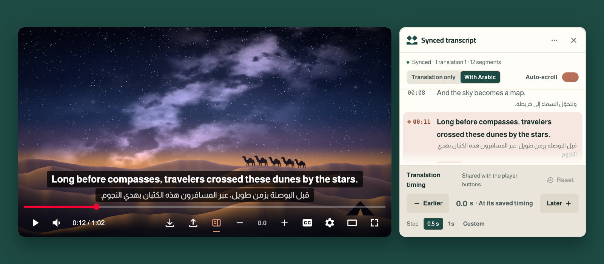
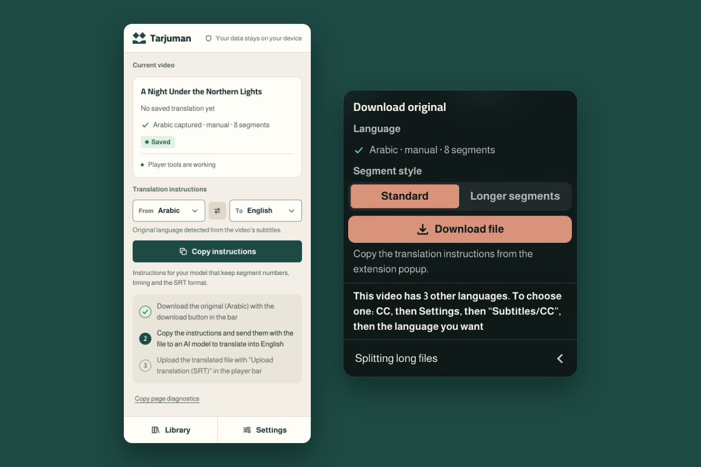
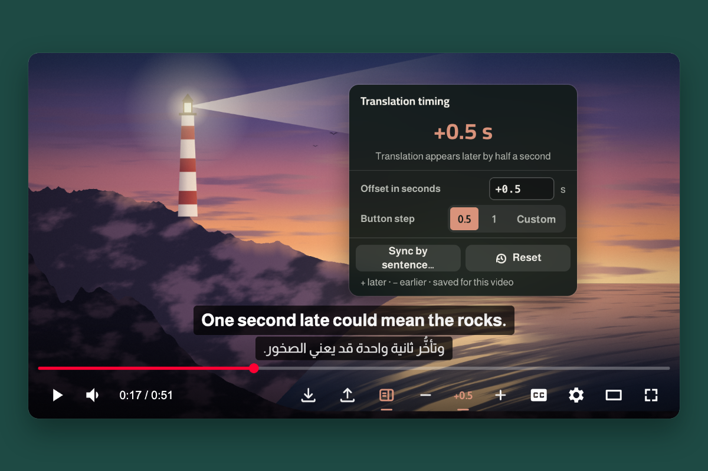
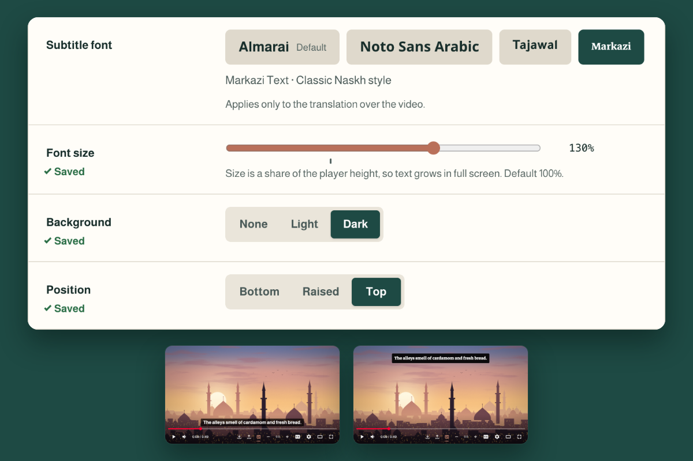
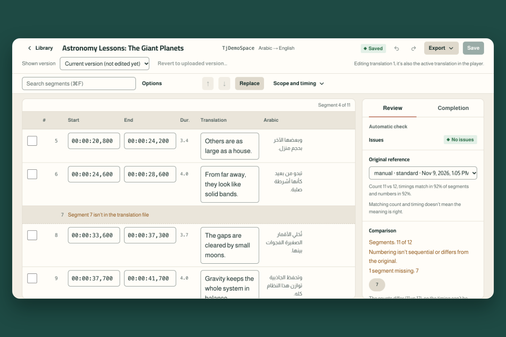

  <picture>
    <source media="(prefers-color-scheme: dark)" srcset=".github/assets/en/banner-dark.png">
    
  </picture>

  <a href="README.md">العربية</a> ·
  <a href="https://bysltan.com/tarjuman">Website</a> ·
  <a href="https://bysltan.com/tarjuman/support">Help</a> ·
  <a href="PRIVACY.md">Privacy (Arabic)</a> ·
  <a href="CHANGELOG.md">Changelog (Arabic)</a>

**Tarjuman** is a desktop browser extension that lets you watch a YouTube video with a translation you make yourself, **from any language to yours**. It saves the video's subtitles that YouTube provides, manual or auto-generated, as an SRT file. You send that file to the AI model you choose to translate it, then upload the translated file. Tarjuman shows it over the same video, lets you adjust its timing and edit it, and keeps it for when you return.

There's no built-in model, no API key, no account, no translation server, and no video or audio download. Everything you save stays in your browser.

> **Release status:** version **2.1.0** is published on Chrome Web Store (which also serves Brave) and Microsoft Edge Add-ons. The repository is on **2.1.1**, not published yet. Tarjuman isn't published on Firefox Add-ons yet.

## Features

- **From any language to yours:** every subtitle track YouTube offers for the video, YouTube's auto-translation labeled with its source language, and any SRT file in any language. YouTube alone decides which languages each video has; Tarjuman doesn't create or switch tracks.
- **Your translation over the video,** in the direction of its language, alone or over the original, in default view, theater and fullscreen. Hidden during ads.
- **The original file from the player bar:** "Download original (SRT)" saves the track you chose in its language.
- **Translation instructions from the popup:** "From" and "To" for any two languages, and one Copy button. The instructions are copied in the interface language.
- **Timing from the player bar:** the − and + buttons move the translation earlier or later, and "Sync by sentence" sets it from a sentence you're hearing. Timing is saved with each translation.
- **Comparison with the original:** shows what's missing, extra, drifted or untranslated, and never changes your file silently.
- **An editor for review:** edit text and timing, merge and split segments, search and replace, and prepare a file with the missing segments to complete them.
- **Synced transcript:** a panel beside the video, closed until you open it.
- **Library:** up to three translations per video, a previous version of what you replaced, and a backup you can move to another browser.
- **Style it your way:** display mode, font, size, background and position.

## Screenshots

<table>
  <tr>
    <td colspan="2" valign="top"> Your translation over the video, with the full text in a panel you can open</td>
  </tr>
  <tr>
    <td width="50%" valign="top"> The original file and instructions; the translation happens outside the extension</td>
    <td width="50%" valign="top"> Timing from the player bar</td>
  </tr>
  <tr>
    <td width="50%" valign="top"> Font, size, background and position</td>
    <td width="50%" valign="top"> The editor: text, timing, review and completion</td>
  </tr>
  <tr>
    <td colspan="2" valign="top"> Library: every video and its translations</td>
  </tr>
</table>

Tarjuman's buttons and pages in these images are captured from the extension itself, on a local demo player with scenes and text prepared for them.

## Install

| Browser | Available now |
| --- | --- |
| Google Chrome (130 or later) | Version 2.1.0 from [Chrome Web Store](https://chromewebstore.google.com/detail/oapjhdkejcohlhhanacplhneohancfpj) |
| Brave (Chromium 130 or later) | Version 2.1.0 from [Chrome Web Store](https://chromewebstore.google.com/detail/oapjhdkejcohlhhanacplhneohancfpj) |
| Microsoft Edge (130 or later) | Version 2.1.0 from [Microsoft Edge Add-ons](https://microsoftedge.microsoft.com/addons/detail/iickeiclgbpdlkalhlofdpphhkohpkgi) |
| Mozilla Firefox (144 or later) | Not on Firefox Add-ons yet |

After installing, pin Tarjuman's icon to the browser toolbar. Tarjuman is for desktop only and works on `www.youtube.com` watch pages, not on Shorts, live streams in progress, or players embedded in other sites.

## How to use it

  <picture>
    <source media="(prefers-color-scheme: dark)" srcset=".github/assets/en/how-it-works-dark.png">
    
  </picture>

1. Open a YouTube video, turn on **CC** and pick the subtitle language. From Tarjuman's buttons in the player bar choose **Download original (SRT)** › **Download file**.
2. In the toolbar popup, under **Translation instructions**, set **From** and **To**, then press **Copy instructions**.
3. Send the file and the instructions to the AI model you choose, and save its output as an SRT file. Tarjuman doesn't translate and doesn't contact any model.
4. Press **Upload translation (SRT)**. Your translation appears over the video. Adjust its timing with **−** and **+**, or open the editor with **Edit translation** in the popup.

The interface comes in Arabic and English. On first run it follows YouTube's interface language, otherwise the browser's; any other language starts in English. Change it in **Settings › Display › Interface language**. Video, subtitle and translation languages aren't affected.

## Privacy

- Your translations and settings stay in the extension's storage on your device and aren't synced with any service. Removing the extension deletes them, so take a backup first.
- Only two things leave the extension: video thumbnails in Library, requested from YouTube's servers by video ID, with a switch to turn them off (off by default on Firefox until you consent); and a problem report you send yourself from Settings after seeing everything in it.
- No usage tracking, no ads, and no selling of your data.

The full policy is at [bysltan.com/tarjuman/privacy](https://bysltan.com/tarjuman/privacy).

## License

All rights reserved © 2026 Sultan ([BySultan](https://bysltan.com)). Tarjuman isn't offered under any open-source license; see [`LICENSE`](LICENSE). Bundled fonts (OFL 1.1) belong to their authors, as listed in [`THIRD_PARTY_NOTICES.txt`](THIRD_PARTY_NOTICES.txt).

YouTube is a trademark of Google LLC. Tarjuman is not affiliated with or endorsed by YouTube or Google.
