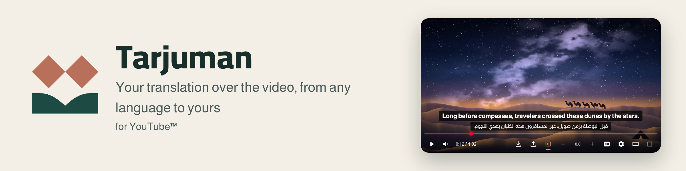
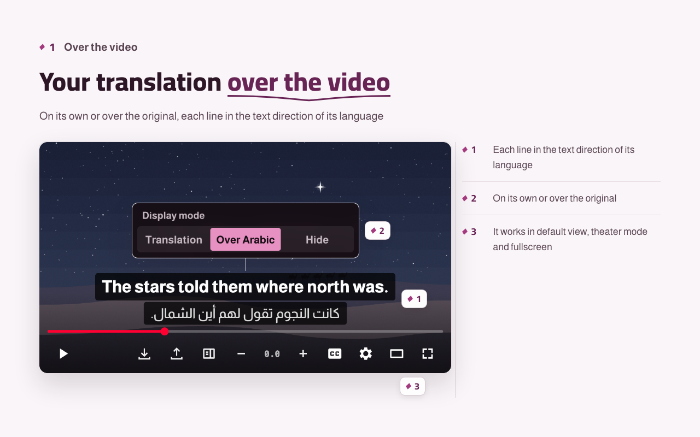
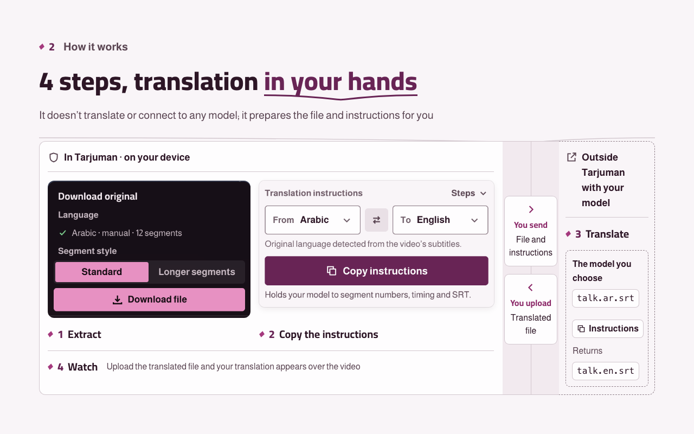
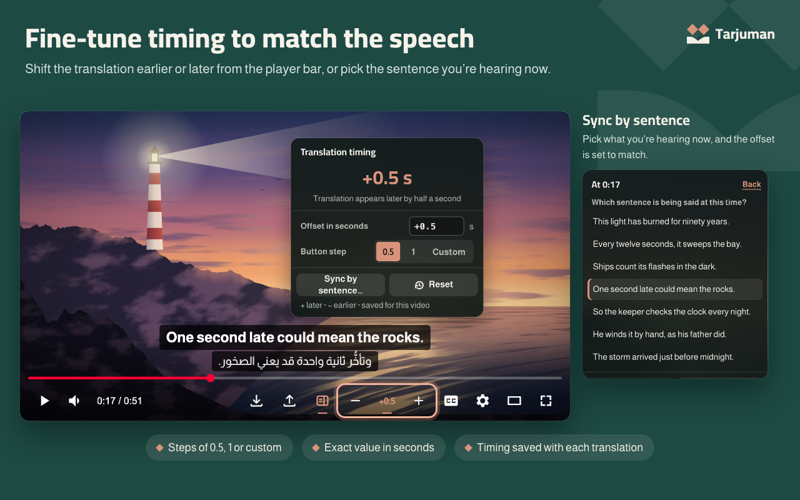
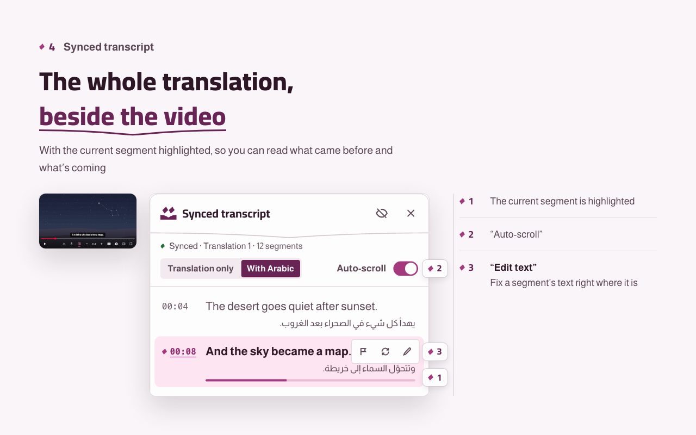
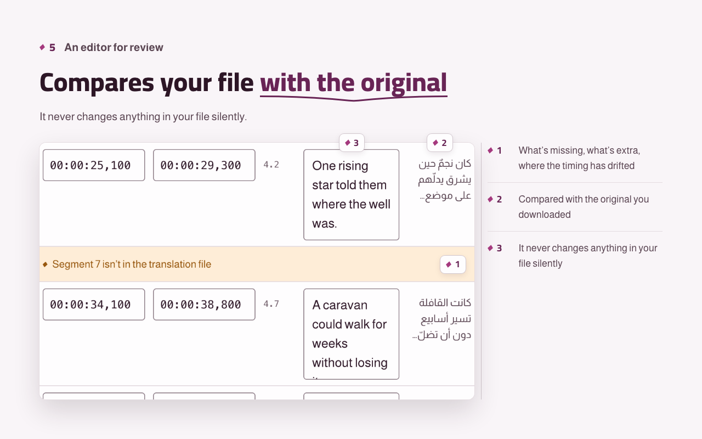
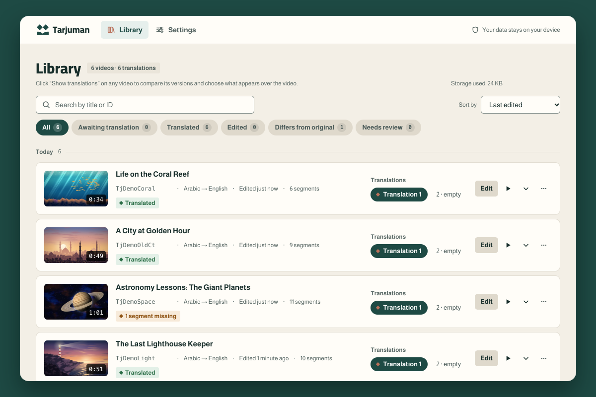
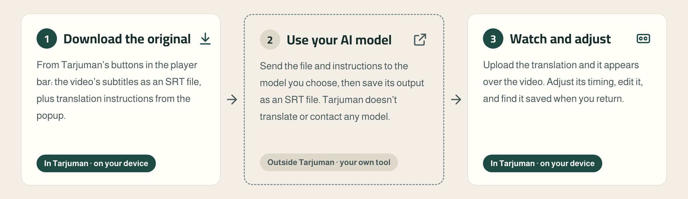

<p align="center">
  <picture>
    <source media="(prefers-color-scheme: dark)" srcset=".github/assets/en/banner-dark.png">
    
  </picture>
</p>

<p align="center">
  <a href="README.md">العربية</a> ·
  <a href="https://bysltan.com/tarjuman">Website</a> ·
  <a href="https://bysltan.com/tarjuman/support">Help</a> ·
  <a href="PRIVACY.md">Privacy (Arabic)</a> ·
  <a href="CHANGELOG.md">Changelog (Arabic)</a>
</p>

**Tarjuman** is a desktop browser extension that lets you watch a YouTube video with a translation you make yourself, **from any language to yours**. It saves the video's subtitles that YouTube provides, manual or auto-generated, as an SRT file. You send that file to the AI model you choose to translate it, then upload the translated file. Tarjuman shows it over the same video, lets you adjust its timing and edit it, and keeps it for when you return.

There's no built-in model, no API key, no account, no translation server, and no video or audio download. Your translations and settings stay in your browser; Library thumbnails are requested from YouTube by video ID only if you turn them on.

> **Release status:** version **2.2.0** (2026-11-11) is published on Chrome Web Store (which also serves Brave), Microsoft Edge Add-ons, and Firefox Add-ons. **3.0.0** is in the repository and hasn't been submitted yet: the new Taa identity (logo, icon, and colors), exporting as WebVTT or with the original, term lists for each language pair, a draft of what you haven't saved in the Editor, fixing a segment's text from the transcript panel, optional keyboard shortcuts, and a button that turns on CC from the "Download original" menu.

## Features

- **From any language to yours:** every subtitle track YouTube offers for the video, YouTube's auto-translation labeled with its source language, and any SRT file in any language. YouTube alone decides which languages each video has; Tarjuman doesn't create or switch tracks.
- **Your translation over the video,** in the direction of its language, alone or over the original, in default view, theater and fullscreen. Hidden during ads.
- **The original file from the player bar:** "Download original (SRT)" saves the track you chose in its language.
- **Translation instructions from the popup:** "From" and "To" for any two languages, and one Copy button. The instructions are copied in the interface language.
- **Timing from the player bar:** the − and + buttons on the player bar, or inside the timing menu when the bar is narrow, move the translation earlier or later, and "Sync by sentence" sets it from a sentence you're hearing. Timing is saved with each translation.
- **Comparison with the original:** when you upload your file, Tarjuman compares it with the original you downloaded and shows what's missing, what's extra, what drifted and what stayed untranslated. It never changes your file silently.
- **An editor for review:** edit text and timing, merge and split segments, search and replace, and mark what you want to return to. It can also prepare a file with the missing segments so you can complete them.
- **Synced transcript:** a panel beside the video shows the whole translation with the current segment highlighted. Closed until you open it from its button.
- **Library:** every video you translated with the languages of each translation, up to three translations per video, a previous version of what you replaced, and a backup you can move to another browser.
- **Style it your way:** display mode, font, size, background and position. Arabic fonts are bundled, and anything they don't cover is drawn with your device's fonts.
- **Interface in Arabic or English:** choose it in Settings. It starts with YouTube's or the browser's language, and any other language starts in English. Video and translation languages and your files aren't affected.

## Screenshots

<table>
  <tr>
    <td width="50%" valign="top"></td>
    <td width="50%" valign="top"></td>
  </tr>
  <tr>
    <td width="50%" valign="top"></td>
    <td width="50%" valign="top"></td>
  </tr>
  <tr>
    <td width="50%" valign="top"></td>
    <td width="50%" valign="top"></td>
  </tr>
</table>

<sub>Tarjuman's buttons and pages in these images are captured from the extension itself, on a local demo player with scenes and text prepared for them.</sub>

## Install

<!-- tj:facts install -->
| Browser | Available now |
| --- | --- |
| Google Chrome (130 or later) | From [Chrome Web Store](https://chromewebstore.google.com/detail/oapjhdkejcohlhhanacplhneohancfpj) |
| Brave (Chromium 130 or later) | From [Chrome Web Store](https://chromewebstore.google.com/detail/oapjhdkejcohlhhanacplhneohancfpj) |
| Microsoft Edge (130 or later) | From [Microsoft Edge Add-ons](https://microsoftedge.microsoft.com/addons/detail/iickeiclgbpdlkalhlofdpphhkohpkgi) |
| Mozilla Firefox (144 or later) | From [Firefox Add-ons](https://addons.mozilla.org/en-US/firefox/addon/tarjuman/) |
<!-- /tj:facts install -->

In every browser, the latest version can be tried from source the same way. The store copy and the source copy are separate extensions, so move your Library between them with a backup ([user guide](docs/user-guide.md) §9, Arabic).

After installing, pin Tarjuman's icon to the browser toolbar: the extensions icon (the puzzle piece), then the pin next to Tarjuman.

Tarjuman is for desktop only. Its buttons appear on `www.youtube.com` watch pages, not on Shorts or in players embedded in other sites. On live streams in progress, only subtitle extraction is blocked; uploading and showing an SRT file still work.

## How to use it

<p align="center">
  <picture>
    <source media="(prefers-color-scheme: dark)" srcset=".github/assets/en/how-it-works-dark.png">
    
  </picture>
</p>

1. Open a YouTube video, turn on **CC** and pick the subtitle language. From Tarjuman's buttons in the player bar choose **Download original (SRT)** › **Download file**.
2. In the toolbar popup, under **Translation instructions**, set **From** and **To**, then press **Copy instructions**.
3. Send the file and the instructions to the AI model you choose, and save its output as an SRT file. Tarjuman doesn't translate and doesn't contact any model.
4. Press **Upload translation (SRT)**. Your translation appears over the video. Adjust its timing with **−** and **+**, or open the editor with **Edit translation** in the popup.

The full guide is in [`docs/user-guide.md`](docs/user-guide.md) (Arabic): timing, the editor, Library, Settings, backups and troubleshooting. Known limitations are in [`docs/known-limitations.md`](docs/known-limitations.md) (Arabic).

The interface comes in Arabic and English. On first run it follows YouTube's interface language, otherwise the browser's; any other language starts in English. Change it in **Settings › Display › Interface language**. Video, subtitle and translation languages aren't affected.

## Privacy

<!-- tj:facts privacy -->
- Your translations and settings stay in the extension's storage on your device and aren't synced with any service. Removing the extension deletes them, so take a backup first.
- Only one thing leaves the extension: **video thumbnails in Library**, off until you turn on their switch in Settings; only then are they requested from YouTube’s servers by video ID. On Firefox, turning them on also asks for your “browsing activity” consent.
- Tarjuman has no server. “Report a problem” in Settings copies the report after you see everything in it, and you send it from your own email to the support address, with no translation text or video ID attached automatically.
- No usage tracking, no ads, and no selling of your data.
<!-- /tj:facts privacy -->

The full policy is in [`PRIVACY.md`](PRIVACY.md) (Arabic), the same text published at [bysltan.com/tarjuman/privacy](https://bysltan.com/tarjuman/privacy).

<details>
<summary><b>Permissions and why they're needed</b></summary>

<!-- tj:facts permissions -->
| Permission | Why |
| --- | --- |
| `storage` | Saving your translations, their languages, the original track, export fingerprints, marks, language preferences, settings, term lists and Editor drafts on your device. |
| `unlimitedStorage` | A two-hour video takes about 0.7 MB, so the default limit fills up after about fifteen long videos. It adds no install warning. |
| `downloads` | Saving only the files you ask for (the original SRT, exported translations and the backup), and querying the extension's own downloads only. |
| `https://www.youtube.com/*` | The content scripts: Tarjuman's buttons in the player, reading a copy of the subtitle response the player requested and the list of its track languages from the page data without any request, and drawing your translation over the video. |
<!-- /tj:facts permissions -->

</details>

## Support

- **A problem with the extension:** Settings › About › "Report a problem", or the [help page](https://bysltan.com/tarjuman/support).
- **Support email:** iSultanBy@gmail.com
- **Security vulnerability:** report it privately as described in [`SECURITY.md`](.github/SECURITY.md), not in a public issue.

## License

All rights reserved © 2026 Sultan ([BySultan](https://bysltan.com)). Tarjuman isn't offered under any open-source license; see [`LICENSE`](LICENSE). Bundled fonts (OFL 1.1) belong to their authors, interface icons are drawn for Tarjuman, and the Lucide (ISC) license for icons in versions up to 1.1.0 is kept for attribution, as listed in [`THIRD_PARTY_NOTICES.txt`](THIRD_PARTY_NOTICES.txt).

YouTube is a trademark of Google LLC. Tarjuman is not affiliated with or endorsed by YouTube or Google.

## Contributing

Code contributions need written permission from the rights holder; the rules are in [`CONTRIBUTING.md`](.github/CONTRIBUTING.md) (Arabic). Reports and suggestions are welcome through the Issues templates or from inside the extension.

## For developers

You need [Node.js](https://nodejs.org/) 22 or later. The dependencies are build and check tools only; none of them ships with the extension.

```bash
npm ci
npm run build
npm run check:all
```

The second command builds the Chromium version in `dist`. The third runs what CI runs except its last step: static checks, secrets, unit tests, both builds, integration, static e2e, and `web-ext lint`. `npm run package` builds, audits and rebuilds the packages from the source package, and CI runs it afterwards. Building for Firefox, installing from source, the repository layout and store packaging are in the [developer guide](docs/development.md) (Arabic), and the docs index is in [`docs/README.md`](docs/README.md) (Arabic).
