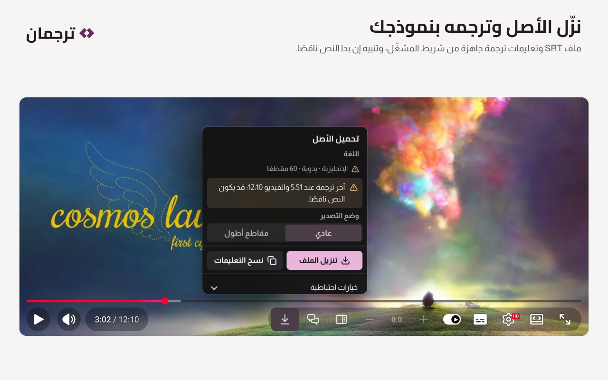
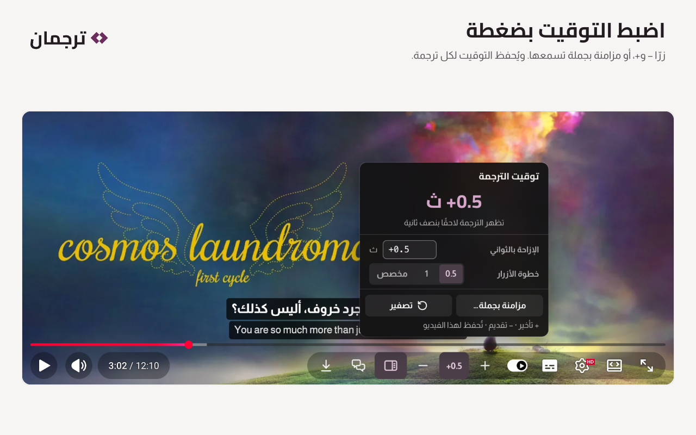
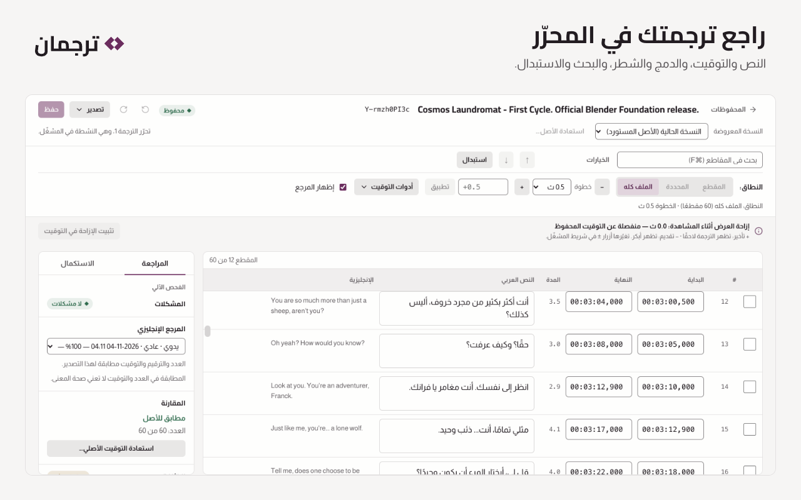
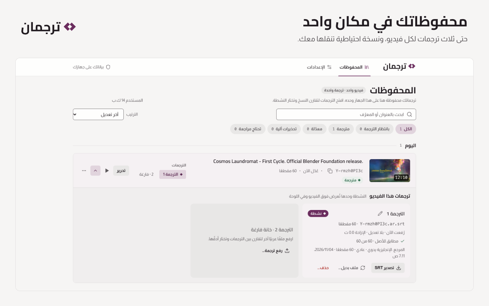
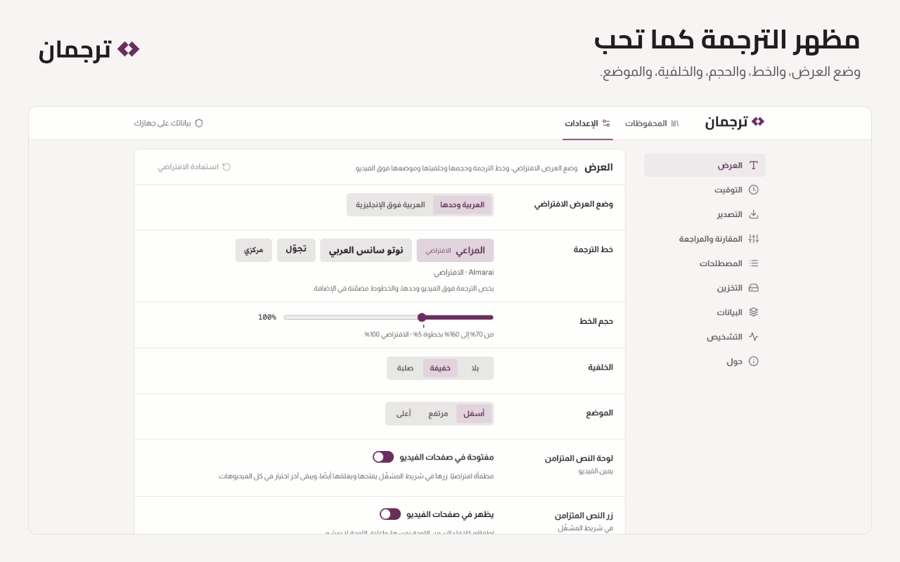

<div dir="rtl">

<p align="center">
  <picture>
    <source media="(prefers-color-scheme: dark)" srcset=".github/assets/banner-dark.png">
    
  </picture>
</p>

<p align="center">
  <a href="https://chromewebstore.google.com/detail/oapjhdkejcohlhhanacplhneohancfpj"></a>
  <a href="https://microsoftedge.microsoft.com/addons/detail/iickeiclgbpdlkalhlofdpphhkohpkgi"></a>
  
  
  <a href="https://github.com/iSltanX/Tarjuman/actions/workflows/ci.yml"></a>
</p>

<p align="center">
  <a href="https://bysltan.com/tarjuman">الموقع</a> ·
  <a href="docs/user-guide.md">دليل الاستخدام</a> ·
  <a href="https://bysltan.com/tarjuman/support">المساعدة</a> ·
  <a href="https://bysltan.com/tarjuman/privacy">الخصوصية</a> ·
  <a href="CHANGELOG.md">سجل التغييرات</a>
</p>

**ترجمان** إضافة للحاسوب تجعلك تشاهد فيديو يوتيوب بترجمة عربية تصنعها أنت. تحفظ الترجمة الإنجليزية للفيديو، اليدوية أو التلقائية، في ملف SRT، فترسله بنفسك إلى نموذج الذكاء الاصطناعي الذي تختاره ليترجمه. ثم ترفع الملف العربي فيعرضه ترجمان فوق الفيديو نفسه، وتضبط توقيته وتحرّره، وتجده محفوظًا متى عدت.

لا نموذج مدمج، ولا مفتاح API، ولا حساب، ولا خادم ترجمة، ولا تنزيل للفيديو أو الصوت. وكل ما تحفظه يبقى في متصفحك.

## المزايا

- **ترجمتك فوق الفيديو** بخط عربي واتجاه صحيح، وحدها أو فوق الإنجليزية، في الوضع العادي والمسرح وملء الشاشة. وتختفي أثناء الإعلانات.
- **ملف الأصل بضغطة:** «تحميل الأصل (SRT)» في شريط المشغّل ينزّل الترجمة الإنجليزية، و«نسخ التعليمات» ينسخ تعليمات ترجمة عربية جاهزة.
- **التوقيت بضغطة:** زرّا − و+ يقدّمان الترجمة أو يؤخّرانها، و«مزامنة بجملة» تضبطها على جملة تسمعها. ويُحفظ التوقيت لكل ترجمة.
- **مقارنة بالأصل:** حين ترفع ملفك يقارنه ترجمان بالأصل الذي نزّلته، فيبيّن ما نقص وما زاد وما انحرف توقيته، ولا يعدّل في ملفك شيئًا بصمت.
- **محرّر للمراجعة:** تعدّل النص والتوقيت، وتدمج المقاطع وتشطرها، وتبحث وتستبدل، وتعلّم ما تعود إليه. ويجهّز لك ملفًا بالمقاطع الناقصة لتستكملها.
- **النص المتزامن:** لوحة بجانب الفيديو تعرض الترجمة كلها والمقطع الحالي مميز. مغلقة حتى تفتحها من زرها.
- **المحفوظات:** كل فيديو ترجمته، بحتى ثلاث ترجمات لكل فيديو، ونسخة سابقة لما استبدلته، ونسخة احتياطية تنقلها إلى متصفح آخر.
- **مظهرها كما تحب:** وضع العرض، والخط، والحجم، والخلفية، والموضع. والخطوط العربية مضمّنة في الإضافة.

## لقطات

<table>
  <tr>
    <td width="50%" valign="top"><br><sub>ترجمتك فوق الفيديو، والنص المتزامن بجانبه</sub></td>
    <td width="50%" valign="top"><br><sub>تنزيل الأصل SRT وتعليمات الترجمة من شريط المشغّل</sub></td>
  </tr>
  <tr>
    <td width="50%" valign="top"><br><sub>ضبط التوقيت بضغطة، أو بمزامنة على جملة</sub></td>
    <td width="50%" valign="top"><br><sub>المحرّر: النص والتوقيت والمراجعة والاستكمال</sub></td>
  </tr>
  <tr>
    <td width="50%" valign="top"><br><sub>المحفوظات: حتى ثلاث ترجمات لكل فيديو</sub></td>
    <td width="50%" valign="top"><br><sub>مظهر الترجمة: الخط والحجم والخلفية والموضع</sub></td>
  </tr>
</table>

<sub>لقطات حقيقية من الإصدار 1.1.0 في Chrome. الفيلم Cosmos Laundromat، (CC) Blender Foundation | gooseberry.blender.org، برخصة CC BY 3.0.</sub>

## التثبيت

| المتصفح | من أين |
| --- | --- |
| Google Chrome ‏(130 فأحدث) | [Chrome Web Store](https://chromewebstore.google.com/detail/oapjhdkejcohlhhanacplhneohancfpj) |
| Brave ‏(Chromium 130 فأحدث) | [Chrome Web Store](https://chromewebstore.google.com/detail/oapjhdkejcohlhhanacplhneohancfpj)، المتجر نفسه |
| Microsoft Edge ‏(130 فأحدث) | [Microsoft Edge Add-ons](https://microsoftedge.microsoft.com/addons/detail/iickeiclgbpdlkalhlofdpphhkohpkgi) |
| Mozilla Firefox ‏(144 فأحدث) | قريبًا في Firefox Add-ons. وللتجربة الآن: [التثبيت من الشيفرة](docs/development.md#التثبيت-من-الشيفرة) |

بعد التثبيت ثبّت أيقونة ترجمان في شريط المتصفح: أيقونة الإضافات (قطعة الأحجية)، ثم الدبوس بجوار «ترجمان».

ترجمان للحاسوب وحده، ويعمل على صفحات المشاهدة في `www.youtube.com`، لا على Shorts ولا البث المباشر الجاري ولا المشغّلات المضمّنة في مواقع أخرى. وإن جرّبته من مجلد قبل نشره، فانقل محفوظاتك إلى نسخة المتجر بالنسخة الاحتياطية ([دليل الاستخدام](docs/user-guide.md) §٩).

## طريقة الاستخدام

<p align="center">
  <picture>
    <source media="(prefers-color-scheme: dark)" srcset=".github/assets/how-it-works-dark.png">
    
  </picture>
</p>

1. **استخرج:** افتح فيديو على يوتيوب وشغّل الترجمة الإنجليزية (CC)، ثم افتح «تحميل الأصل (SRT)» من أزرار ترجمان في شريط المشغّل. «تنزيل الملف» يحفظ ملف الترجمة، و«نسخ التعليمات» ينسخ تعليمات الترجمة.
2. **ترجم:** أرسل الملف والتعليمات إلى النموذج الذي تختاره، واحفظ ناتجه ملف SRT. ترجمان لا يترجم، ولا يتصل بأي نموذج.
3. **شاهد:** ارفع الملف العربي بزر «رفع الترجمة العربية (SRT)»، فتظهر ترجمتك فوق الفيديو. ثم اضبط توقيتها أو حرّرها، وتجدها محفوظة متى عدت.

والشرح الكامل في [دليل الاستخدام](docs/user-guide.md): التوقيت، والمحرّر، والمحفوظات، والإعدادات، والنسخ الاحتياطي، وحل المشكلات. والقيود المعروفة في [`docs/known-limitations.md`](docs/known-limitations.md).

## الخصوصية

- ترجماتك وإعداداتك في تخزين الإضافة على جهازك، ولا تُزامَن مع أي خدمة. وإزالة الإضافة تحذفها، فخذ نسخة احتياطية قبلها.
- لا يخرج من الإضافة إلا شيئان:
  - **صور الفيديو في «المحفوظات»:** تُطلب من خوادم يوتيوب بمعرّف الفيديو، ولها مفتاح يطفئها. وفي Firefox هي مطفأة حتى تفعّل مفتاحها وتوافق على «نشاط التصفح».
  - **بلاغ عن مشكلة:** ترسله أنت بنفسك من الإعدادات بعد أن ترى كل ما فيه، ولا يُرفق به تلقائيًا نص ترجمة ولا معرّف فيديو.
- لا قياس استخدام، ولا إعلانات، ولا بيع لبياناتك.

السياسة الكاملة في [`PRIVACY.md`](PRIVACY.md)، وهي النص المنشور نفسه في [bysltan.com/tarjuman/privacy](https://bysltan.com/tarjuman/privacy).

<details>
<summary><b>الأذونات ولماذا يطلبها</b></summary>

| الإذن | لماذا |
| --- | --- |
| `storage` | حفظ ترجماتك ومرجعها الإنجليزي وبصمات التصدير والعلامات والإعدادات على جهازك. |
| `unlimitedStorage` | فيديو بساعتين نحو 0.7 م.ب، فالحد الافتراضي يمتلئ بنحو خمسة عشر فيديو طويلًا. ولا يضيف تحذير تثبيت. |
| `downloads` | حفظ الملفات التي تطلبها وحدها (ملف SRT الإنجليزي، والترجمات المصدَّرة، والنسخة الاحتياطية)، والاستعلام عن تنزيلات الإضافة وحدها. |
| `https://www.youtube.com/*` | سكربتا المحتوى: أزرار ترجمان في المشغّل، وقراءة نسخة رد الترجمة الذي طلبه المشغّل، ورسم ترجمتك فوق الفيديو. |
| خادم البلاغات (اختياري) | يُطلب عند أول ضغطة «أرسل البلاغ» بعد المعاينة، ولا يُستعمل لغيره. وإن رفضته لا يُرسل شيء. |

</details>

## الدعم

- **مشكلة في الإضافة:** من الإعدادات ← حول ← «الإبلاغ عن مشكلة»، أو من [صفحة المساعدة](https://bysltan.com/tarjuman/support).
- **بريد الدعم:** iSultanBy@gmail.com
- **ثغرة أمنية:** بلّغ عنها سرًّا كما في [`SECURITY.md`](.github/SECURITY.md)، لا في مشكلة عامة.

## الترخيص

جميع الحقوق محفوظة © 2026 سلطان ([BySultan](https://bysltan.com)). ترجمان غير مطروح بأي ترخيص مفتوح المصدر، والتفصيل في [`LICENSE`](LICENSE). والخطوط المضمّنة (OFL 1.1) والأيقونات (Lucide برخصة ISC) لأصحابها، ونسبتها في [`THIRD_PARTY_NOTICES.txt`](THIRD_PARTY_NOTICES.txt).

يوتيوب (YouTube) علامة تجارية لشركة Google LLC. وترجمان لا صلة له بيوتيوب ولا بـGoogle، ولا يحظى بتأييدهما.

## المساهمة

المساهمة في الشيفرة بإذن مكتوب من صاحب الحقوق، وقواعدها في [`CONTRIBUTING.md`](.github/CONTRIBUTING.md). والبلاغات والاقتراحات مرحّب بها من قوالب «Issues» أو من داخل الإضافة.

## للمطوّرين

يلزم [Node.js](https://nodejs.org/) ‏22 فأحدث. والاعتماديات أدوات بناء وفحص وحدها، ولا يُشحن منها شيء مع الإضافة.

<div dir="ltr">

```bash
npm ci
npm run build
npm run check
```

</div>

يبني الأمر الثاني نسخة Chromium في `dist`، والثالث يشغّل الفحوص الثابتة واختبارات الوحدة والبناءين. والبناء لـFirefox، والتثبيت من الشيفرة، وبقية الفحوص، وهيكل المستودع، والتغليف للمتاجر، كلها في [دليل المطوّرين](docs/development.md). وفهرس الوثائق في [`docs/README.md`](docs/README.md).

</div>
