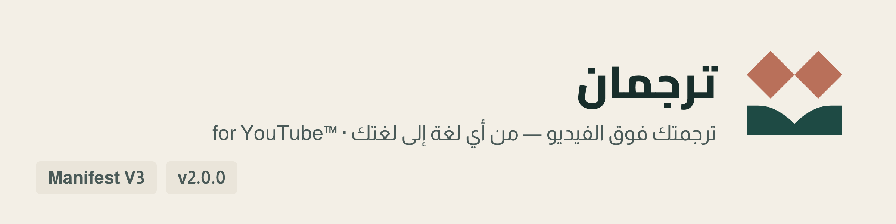
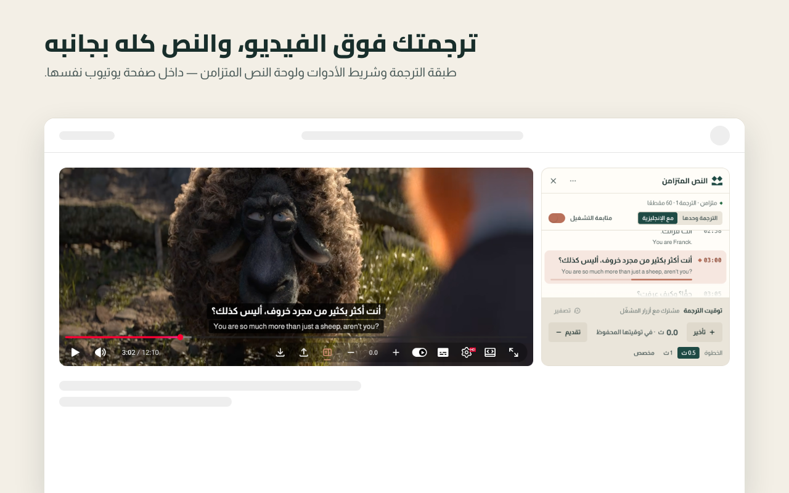
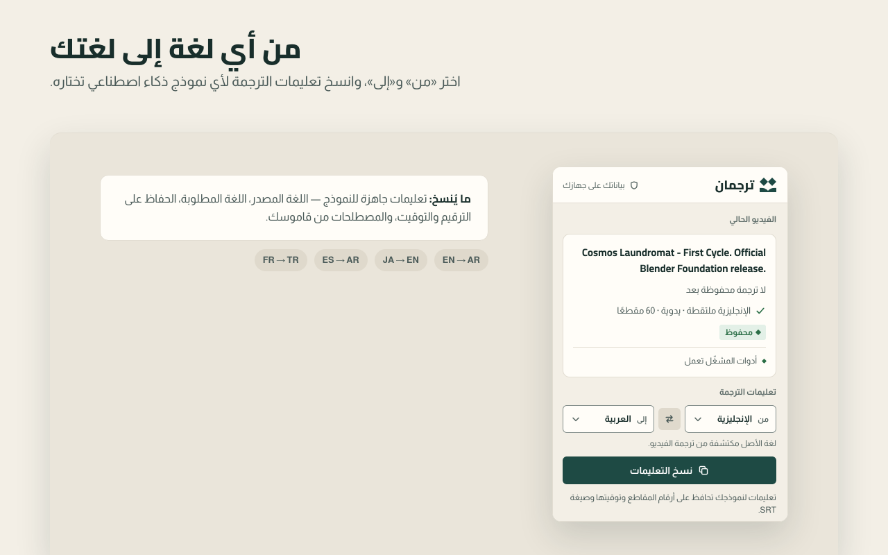
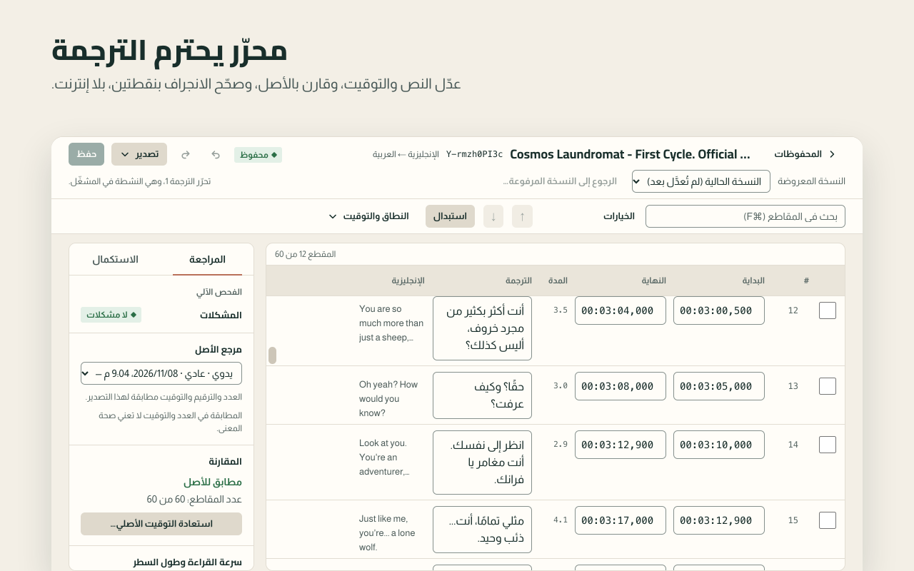
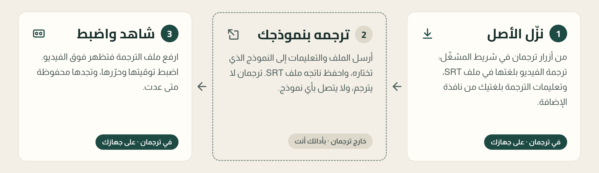

<div dir="rtl">

<p align="center">
  <picture>
    <source media="(prefers-color-scheme: dark)" srcset=".github/assets/banner-dark.png">
    
  </picture>
</p>

<p align="center">
  <a href="https://chromewebstore.google.com/detail/oapjhdkejcohlhhanacplhneohancfpj"></a>
  <a href="https://microsoftedge.microsoft.com/addons/detail/iickeiclgbpdlkalhlofdpphhkohpkgi"></a>
  
  <a href="https://github.com/iSltanX/Tarjuman/actions/workflows/ci.yml"></a>
</p>

<p align="center">
  <a href="https://bysltan.com/tarjuman">الموقع</a> ·
  <a href="docs/user-guide.md">دليل الاستخدام</a> ·
  <a href="https://bysltan.com/tarjuman/support">المساعدة</a> ·
  <a href="PRIVACY.md">الخصوصية</a> ·
  <a href="CHANGELOG.md">سجل التغييرات</a>
</p>

**ترجمان** إضافة للحاسوب تجعلك تشاهد فيديو يوتيوب بترجمة تصنعها أنت، **من أي لغة إلى لغتك**. تحفظ ترجمة الفيديو التي يوفّرها يوتيوب، اليدوية أو التلقائية، في ملف SRT، فترسله بنفسك إلى نموذج الذكاء الاصطناعي الذي تختاره ليترجمه. ثم ترفع الملف المترجم فيعرضه ترجمان فوق الفيديو نفسه، وتضبط توقيته وتحرّره، وتجده محفوظًا متى عدت.

لا نموذج مدمج، ولا مفتاح API، ولا حساب، ولا خادم ترجمة، ولا تنزيل للفيديو أو الصوت. وكل ما تحفظه يبقى في متصفحك.

> **حالة الإصدار:** المنشور الآن في Chrome Web Store وMicrosoft Edge Add-ons هو الإصدار **2.0.0** (من أي لغة إلى لغتك، ونسخ التعليمات من نافذة الإضافة، والهوية الجديدة). وهذا المستودع يضيف بعده ما لم يُنشر بعد: الواجهة بالعربية والإنجليزية، ونصوص أوضح في الأزرار والرسائل؛ فتجربته الآن من الشيفرة. ولم يُنشر ترجمان في Firefox Add-ons بعد.

## المزايا

ما يلي وصف النسخة التي في المستودع:

- **من أي لغة إلى لغتك:** كل مسار ترجمة يوفّره يوتيوب للفيديو، وترجمة يوتيوب الآلية موسومةً بلغة أصلها، وأي ملف SRT بأي لغة. واللغات المتاحة لكل فيديو يحددها يوتيوب وحده، وترجمان لا ينشئ مسارًا ولا يبدّله.
- **ترجمتك فوق الفيديو** باتجاه لغتها، وحدها أو فوق الأصل، في الوضع العادي والمسرح وملء الشاشة. وتختفي أثناء الإعلانات.
- **ملف الأصل بضغطة:** «تنزيل الأصل (SRT)» في شريط المشغّل ينزّل المسار الذي اخترته بلغته. و**تعليمات الترجمة من نافذة الإضافة**: «من» و«إلى» لأي لغتين، وزر نسخ واحد.
- **التوقيت بضغطة:** زرّا − و+ يقدّمان الترجمة أو يؤخّرانها، و«مزامنة بجملة» تضبطها على جملة تسمعها. ويُحفظ التوقيت لكل ترجمة.
- **مقارنة بالأصل:** حين ترفع ملفك يقارنه ترجمان بالأصل الذي نزّلته، فيبيّن ما نقص وما زاد وما انحرف توقيته وما بقي غير مترجم، ولا يعدّل في ملفك شيئًا بصمت.
- **محرّر للمراجعة:** تعدّل النص والتوقيت، وتدمج المقاطع وتشطرها، وتبحث وتستبدل، وتعلّم ما تعود إليه. ويجهّز لك ملفًا بالمقاطع الناقصة لتستكملها.
- **النص المتزامن:** لوحة بجانب الفيديو تعرض الترجمة كلها والمقطع الحالي مميز. مغلقة حتى تفتحها من زرها.
- **المحفوظات:** كل فيديو ترجمته بلغتي كل ترجمة، وحتى ثلاث ترجمات لكل فيديو، ونسخة سابقة لما استبدلته، ونسخة احتياطية تنقلها إلى متصفح آخر.
- **مظهرها كما تحب:** وضع العرض، والخط، والحجم، والخلفية، والموضع. والخطوط العربية مضمّنة، وما لا تحويه يُرسم بخطوط جهازك.
- **واجهتها بالعربية أو الإنجليزية:** تختار لغتها من الإعدادات، وتبدأ عند أول تشغيل بلغة يوتيوب أو المتصفح، وأي لغة أخرى تبدأ بالإنجليزية. ولا تتأثر لغات الفيديو والترجمة ولا ملفاتك.

## لقطات

<table>
  <tr>
    <td colspan="2" valign="top"><br><sub>ترجمتك فوق الفيديو، والنص كله بجانبه</sub></td>
  </tr>
  <tr>
    <td width="50%" valign="top"><br><sub>من أي لغة إلى لغتك: «من» و«إلى» وزر نسخ واحد</sub></td>
    <td width="50%" valign="top"><br><sub>المحرّر: النص والتوقيت والمراجعة والاستكمال</sub></td>
  </tr>
</table>

<sub>لقطات حقيقية من الإصدار 2.0.0 في Chrome، في إطارات مواد المتاجر. الفيلم Cosmos Laundromat، (CC) Blender Foundation | gooseberry.blender.org، برخصة CC BY 3.0.</sub>

## التثبيت

| المتصفح | المتاح الآن |
| --- | --- |
| Google Chrome ‏(130 فأحدث) | الإصدار 2.0.0 من [Chrome Web Store](https://chromewebstore.google.com/detail/oapjhdkejcohlhhanacplhneohancfpj) |
| Brave ‏(Chromium 130 فأحدث) | الإصدار 2.0.0 من [Chrome Web Store](https://chromewebstore.google.com/detail/oapjhdkejcohlhhanacplhneohancfpj)، المتجر نفسه |
| Microsoft Edge ‏(130 فأحدث) | الإصدار 2.0.0 من [Microsoft Edge Add-ons](https://microsoftedge.microsoft.com/addons/detail/iickeiclgbpdlkalhlofdpphhkohpkgi) |
| Mozilla Firefox ‏(144 فأحدث) | غير منشور في Firefox Add-ons بعد. وللتجربة: [التثبيت من الشيفرة](docs/development.md#التثبيت-من-الشيفرة) |

وفي كل المتصفحات تُجرَّب نسخة المستودع من الشيفرة بالطريقة نفسها. ونسخة المتجر ونسخة الشيفرة إضافتان منفصلتان، فانقل محفوظاتك بينهما بالنسخة الاحتياطية ([دليل الاستخدام](docs/user-guide.md) §٩).

بعد التثبيت ثبّت أيقونة ترجمان في شريط المتصفح: أيقونة الإضافات (قطعة الأحجية)، ثم الدبوس بجوار «ترجمان».

ترجمان للحاسوب وحده، ويعمل على صفحات المشاهدة في `www.youtube.com`، لا على Shorts ولا البث المباشر الجاري ولا المشغّلات المضمّنة في مواقع أخرى.

## طريقة الاستخدام

<p align="center">
  <picture>
    <source media="(prefers-color-scheme: dark)" srcset=".github/assets/how-it-works-dark.png">
    
  </picture>
</p>

1. **استخرج:** افتح فيديو على يوتيوب، واختر لغة الترجمة من CC في المشغّل، ثم «تنزيل الأصل (SRT)» ← «تنزيل الملف» من أزرار ترجمان في شريط المشغّل.
2. **انسخ التعليمات:** من نافذة ترجمان في شريط المتصفح: «من» لغة الملف كما أرسلها يوتيوب، واختر «إلى»، ثم «نسخ التعليمات».
3. **ترجم:** أرسل الملف والتعليمات إلى النموذج الذي تختاره، واحفظ ناتجه ملف SRT. ترجمان لا يترجم، ولا يتصل بأي نموذج.
4. **شاهد:** ارفع الملف بزر «رفع الترجمة (SRT)»، فتظهر ترجمتك فوق الفيديو. ثم اضبط توقيتها أو حرّرها، وتجدها محفوظة متى عدت.

والشرح الكامل في [دليل الاستخدام](docs/user-guide.md): التوقيت، والمحرّر، والمحفوظات، والإعدادات، والنسخ الاحتياطي، وحل المشكلات. والقيود المعروفة في [`docs/known-limitations.md`](docs/known-limitations.md).

<details>
<summary><b>English interface</b></summary>

<div dir="ltr">

Tarjuman's interface comes in Arabic and English. This is in the repository version and hasn't reached the stores yet. On first run it follows YouTube's interface language, otherwise the browser's; any other language starts in English. Change it in **Settings › Display › Interface language**. Video, subtitle and translation languages aren't affected.

1. Open a YouTube video, turn on **CC** and pick the subtitle language. From Tarjuman's buttons in the player bar choose **Download original (SRT)** › **Download file**.
2. In the toolbar popup, under **Translation instructions**, set **From** and **To**, then press **Copy instructions**. The copied instructions are in Arabic whatever the interface language.
3. Send the file and the instructions to the AI model you choose, and save its output as an SRT file. Tarjuman doesn't translate and doesn't contact any model.
4. Press **Upload translation (SRT)**. Your translation appears over the video. Adjust its timing with **−** and **+**, or open the editor with **Edit translation** in the popup.

</div>
</details>

## الخصوصية

- ترجماتك وإعداداتك في تخزين الإضافة على جهازك، ولا تُزامَن مع أي خدمة. وإزالة الإضافة تحذفها، فخذ نسخة احتياطية قبلها.
- لا يخرج من الإضافة إلا شيئان:
  - **صور الفيديو في «المحفوظات»:** تُطلب من خوادم يوتيوب بمعرّف الفيديو، ولها مفتاح يطفئها. وفي Firefox هي مطفأة حتى تفعّل مفتاحها وتوافق على «نشاط التصفح».
  - **بلاغ عن مشكلة:** ترسله أنت بنفسك من الإعدادات بعد أن ترى كل ما فيه، ولا يُرفق به تلقائيًا نص ترجمة ولا معرّف فيديو.
- لا قياس استخدام، ولا إعلانات، ولا بيع لبياناتك.

السياسة الكاملة في [`PRIVACY.md`](PRIVACY.md)، وهي النص المنشور نفسه في [bysltan.com/tarjuman/privacy](https://bysltan.com/tarjuman/privacy).

<details>
<summary><b>الأذونات ولماذا يطلبها</b></summary>

| الإذن | لماذا |
| --- | --- |
| `storage` | حفظ ترجماتك ولغاتها ومسار الأصل وبصمات التصدير والعلامات وتفضيلات اللغات والإعدادات على جهازك. |
| `unlimitedStorage` | فيديو بساعتين نحو 0.7 م.ب، فالحد الافتراضي يمتلئ بنحو خمسة عشر فيديو طويلًا. ولا يضيف تحذير تثبيت. |
| `downloads` | حفظ الملفات التي تطلبها وحدها (ملف SRT الأصلي، والترجمات المصدَّرة، والنسخة الاحتياطية)، والاستعلام عن تنزيلات الإضافة وحدها. |
| `https://www.youtube.com/*` | سكربتا المحتوى: أزرار ترجمان في المشغّل، وقراءة نسخة رد الترجمة الذي طلبه المشغّل وقائمة لغات مساراته من بيانات الصفحة بلا طلب، ورسم ترجمتك فوق الفيديو. |
| خادم البلاغات (اختياري) | يُطلب عند أول ضغطة «إرسال البلاغ» بعد المعاينة، ولا يُستعمل لغيره. وإن رفضته لا يُرسل شيء. |

</details>

## الدعم

- **مشكلة في الإضافة:** من الإعدادات ← حول ← «الإبلاغ عن مشكلة»، أو من [صفحة المساعدة](https://bysltan.com/tarjuman/support).
- **بريد الدعم:** iSultanBy@gmail.com
- **ثغرة أمنية:** بلّغ عنها سرًّا كما في [`SECURITY.md`](.github/SECURITY.md)، لا في مشكلة عامة.

## الترخيص

جميع الحقوق محفوظة © 2026 سلطان ([BySultan](https://bysltan.com)). ترجمان غير مطروح بأي ترخيص مفتوح المصدر، والتفصيل في [`LICENSE`](LICENSE). والخطوط المضمّنة (OFL 1.1) لأصحابها، وأيقونات الواجهة مرسومة لترجمان، وترخيص Lucide (ISC) لأيقونات الإصدارات حتى 1.1.0 باقٍ للإسناد، ونسبة ذلك كله في [`THIRD_PARTY_NOTICES.txt`](THIRD_PARTY_NOTICES.txt).

يوتيوب (YouTube) علامة تجارية لشركة Google LLC. وترجمان لا صلة له بيوتيوب ولا بـGoogle، ولا يحظى بتأييدهما.

## المساهمة

المساهمة في الشيفرة بإذن مكتوب من صاحب الحقوق، وقواعدها في [`CONTRIBUTING.md`](.github/CONTRIBUTING.md). والبلاغات والاقتراحات مرحّب بها من قوالب «Issues» أو من داخل الإضافة.

## للمطوّرين

يلزم [Node.js](https://nodejs.org/) ‏22 فأحدث. والاعتماديات أدوات بناء وفحص وحدها، ولا يُشحن منها شيء مع الإضافة.

<div dir="ltr">

```bash
npm ci
npm run build
npm run check:all
```

</div>

يبني الأمر الثاني نسخة Chromium في `dist`، والثالث يشغّل الفحوص كلها كما في CI: الثابتة، والأسرار، والوحدة، والتكامل، وe2e الثابت، والبناءين، و`web-ext lint`. والبناء لـFirefox، والتثبيت من الشيفرة، وهيكل المستودع، والتغليف للمتاجر، كلها في [دليل المطوّرين](docs/development.md). وفهرس الوثائق في [`docs/README.md`](docs/README.md).

</div>
