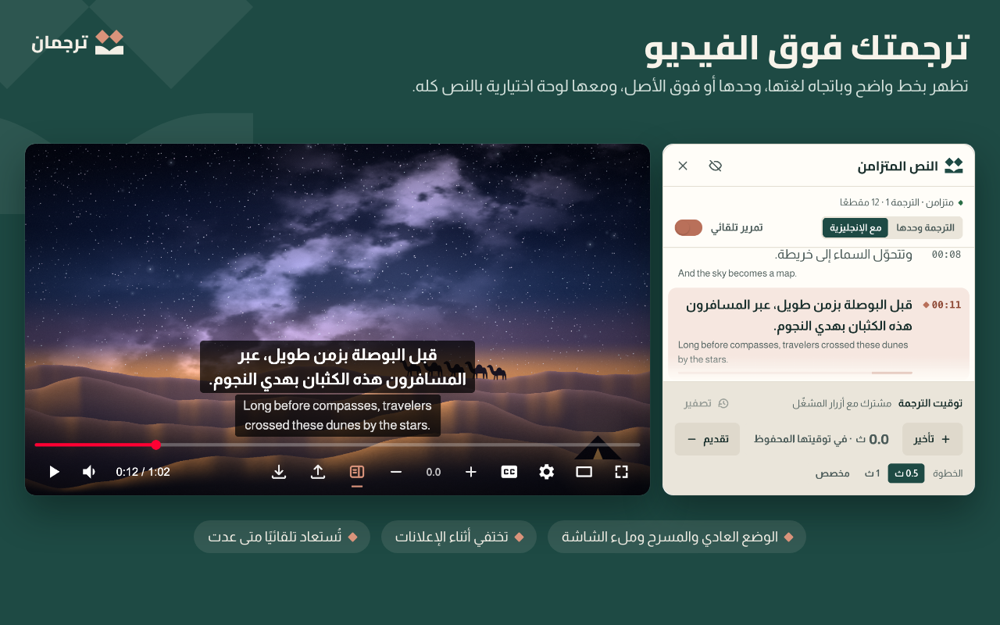
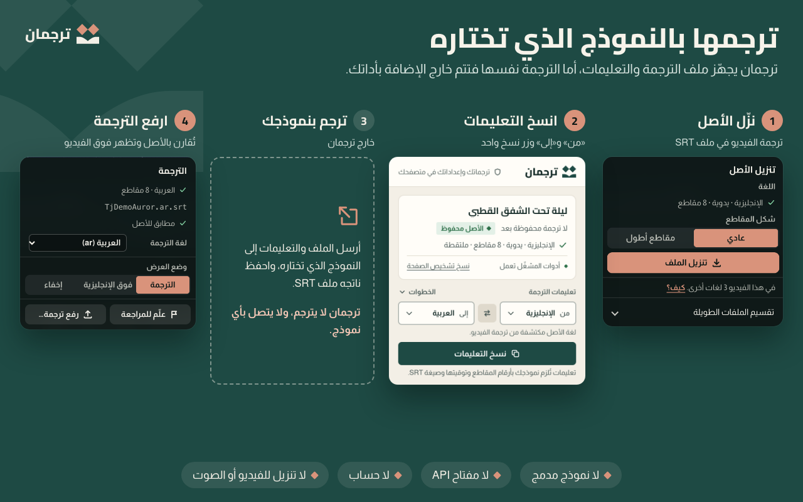
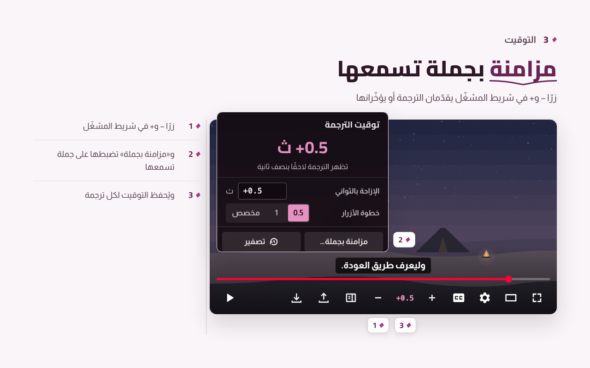
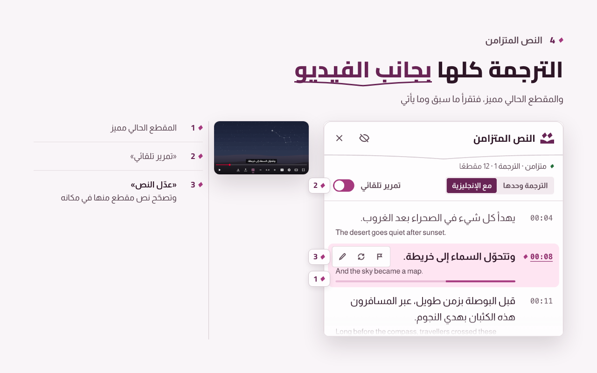
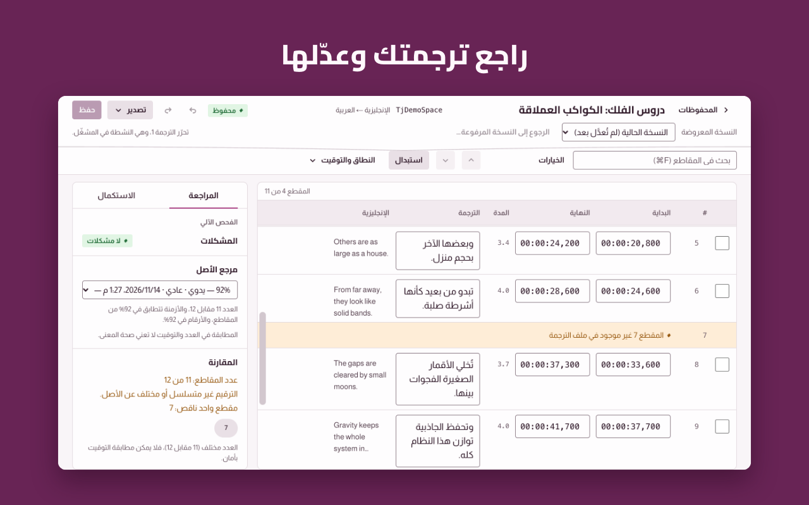
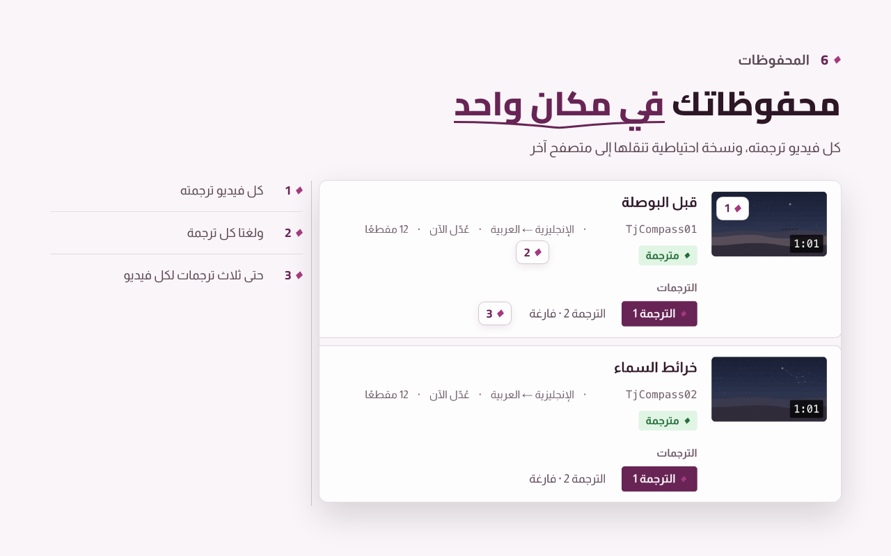

<div dir="rtl">

<p align="center">
  <picture>
    <source media="(prefers-color-scheme: dark)" srcset=".github/assets/banner-dark.png">
    
  </picture>
</p>

<p align="center">
<!-- tj:facts badges -->
  <a href="https://chromewebstore.google.com/detail/oapjhdkejcohlhhanacplhneohancfpj"></a>
  <a href="https://microsoftedge.microsoft.com/addons/detail/iickeiclgbpdlkalhlofdpphhkohpkgi"></a>
  <a href="https://addons.mozilla.org/en-US/firefox/addon/tarjuman/"></a>
<!-- /tj:facts badges -->
  
  <a href="https://github.com/iSltanX/Tarjuman/actions/workflows/ci.yml"></a>
</p>

<p align="center">
  <a href="https://bysltan.com/tarjuman">الموقع</a> ·
  <a href="README.en.md">English</a> ·
  <a href="docs/user-guide.md">دليل الاستخدام</a> ·
  <a href="https://bysltan.com/tarjuman/support">المساعدة</a> ·
  <a href="PRIVACY.md">الخصوصية</a> ·
  <a href="CHANGELOG.md">سجل التغييرات</a>
</p>

**ترجمان** إضافة للحاسوب تجعلك تشاهد فيديو يوتيوب بترجمة تصنعها أنت، **من أي لغة إلى لغتك**. تحفظ ترجمة الفيديو التي يوفّرها يوتيوب، اليدوية أو التلقائية، في ملف SRT، فترسله بنفسك إلى نموذج الذكاء الاصطناعي الذي تختاره ليترجمه. ثم ترفع الملف المترجم فيعرضه ترجمان فوق الفيديو نفسه، وتضبط توقيته وتحرّره، وتجده محفوظًا متى عدت.

لا نموذج مدمج، ولا مفتاح API، ولا حساب، ولا خادم ترجمة، ولا تنزيل للفيديو أو الصوت. وترجماتك وإعداداتك تبقى في متصفحك، وصور المحفوظات لا تُطلب من يوتيوب بمعرّف الفيديو إلا إن فعّلتها.

> **حالة الإصدار:** المنشور **2.2.0** (2026-11-11) في Chrome Web Store (ومنه Brave) وMicrosoft Edge Add-ons وFirefox Add-ons. و**3.0.0** في المستودع ولم يُرفع بعد: الهوية الجديدة «التاء» (الشعار والأيقونة والألوان)، والتصدير بصيغة WebVTT أو مع الأصل، وقوائم مصطلحات لكل زوج لغتين، ومسودة لما لم تحفظه في المحرّر، وتصحيح نص المقطع من لوحة النص، واختصارات اختيارية للوحة المفاتيح، وزر يشغّل CC من قائمة «تنزيل الأصل».

## المزايا

ما يلي وصف الإصدار الأحدث في المستودع:

- **من أي لغة إلى لغتك:** كل مسار ترجمة يوفّره يوتيوب للفيديو، وترجمة يوتيوب الآلية موسومةً بلغة أصلها، وأي ملف SRT بأي لغة. واللغات المتاحة لكل فيديو يحددها يوتيوب وحده، وترجمان لا ينشئ مسارًا ولا يبدّله.
- **ترجمتك فوق الفيديو** باتجاه لغتها، وحدها أو فوق الأصل، في الوضع العادي والمسرح وملء الشاشة. وتختفي أثناء الإعلانات.
- **ملف الأصل من شريط المشغّل:** «تنزيل الأصل (SRT)» في شريط المشغّل ينزّل المسار الذي اخترته بلغته. و**تعليمات الترجمة من نافذة الإضافة**: «من» و«إلى» لأي لغتين، وزر نسخ واحد، وتُنسخ التعليمات بلغة الواجهة.
- **التوقيت من شريط المشغّل:** زرّا − و+ في شريط المشغّل، أو داخل قائمة التوقيت حين يضيق الشريط، يقدّمان الترجمة أو يؤخّرانها، و«مزامنة بجملة» تضبطها على جملة تسمعها. ويُحفظ التوقيت لكل ترجمة.
- **مقارنة بالأصل:** حين ترفع ملفك يقارنه ترجمان بالأصل الذي نزّلته، فيبيّن ما نقص وما زاد وما انحرف توقيته وما بقي غير مترجم، ولا يعدّل في ملفك شيئًا بصمت.
- **محرّر للمراجعة:** تعدّل النص والتوقيت، وتدمج المقاطع وتشطرها، وتبحث وتستبدل، وتعلّم ما تعود إليه. ويجهّز لك ملفًا بالمقاطع الناقصة لتستكملها.
- **النص المتزامن:** لوحة بجانب الفيديو تعرض الترجمة كلها والمقطع الحالي مميز. مغلقة حتى تفتحها من زرها.
- **المحفوظات:** كل فيديو ترجمته بلغتي كل ترجمة، وحتى ثلاث ترجمات لكل فيديو، ونسخة سابقة لما استبدلته، ونسخة احتياطية تنقلها إلى متصفح آخر.
- **مظهرها كما تحب:** وضع العرض، والخط، والحجم، والخلفية، والموضع. والخطوط العربية مضمّنة، وما لا تحويه يُرسم بخطوط جهازك.
- **واجهتها بالعربية أو الإنجليزية:** تختار لغتها من الإعدادات، وتبدأ عند أول تشغيل بلغة يوتيوب أو المتصفح، وأي لغة أخرى تبدأ بالإنجليزية. ولا تتأثر لغات الفيديو والترجمة ولا ملفاتك.

## لقطات

<table>
  <tr>
    <td width="50%" valign="top"></td>
    <td width="50%" valign="top"></td>
  </tr>
  <tr>
    <td width="50%" valign="top"></td>
    <td width="50%" valign="top"></td>
  </tr>
  <tr>
    <td width="50%" valign="top"></td>
    <td width="50%" valign="top"></td>
  </tr>
</table>

<sub>أزرار ترجمان وصفحاته في الصور لقطات من الإضافة نفسها، على مشغّل محلي تجريبي بمشاهد ونصوص أُعدّت لهذه الصور.</sub>

## التثبيت

<!-- tj:facts install -->
| المتصفح | المتاح الآن |
| --- | --- |
| Google Chrome ‏(130 فأحدث) | من [Chrome Web Store](https://chromewebstore.google.com/detail/oapjhdkejcohlhhanacplhneohancfpj) |
| Brave ‏(Chromium 130 فأحدث) | من [Chrome Web Store](https://chromewebstore.google.com/detail/oapjhdkejcohlhhanacplhneohancfpj)، المتجر نفسه |
| Microsoft Edge ‏(130 فأحدث) | من [Microsoft Edge Add-ons](https://microsoftedge.microsoft.com/addons/detail/iickeiclgbpdlkalhlofdpphhkohpkgi) |
| Mozilla Firefox ‏(144 فأحدث) | من [Firefox Add-ons](https://addons.mozilla.org/en-US/firefox/addon/tarjuman/) |
<!-- /tj:facts install -->

وفي كل المتصفحات يُجرَّب الإصدار الأحدث من الشيفرة بالطريقة نفسها. ونسخة المتجر ونسخة الشيفرة إضافتان منفصلتان، فانقل محفوظاتك بينهما بالنسخة الاحتياطية ([دليل الاستخدام](docs/user-guide.md) §٩).

بعد التثبيت ثبّت أيقونة ترجمان في شريط المتصفح: أيقونة الإضافات (قطعة الأحجية)، ثم الدبوس بجوار «ترجمان».

ترجمان للحاسوب وحده، وتظهر أزراره في صفحات المشاهدة في `www.youtube.com`، لا في Shorts ولا في المشغّلات المضمّنة في مواقع أخرى. وفي البث المباشر الجاري يُمنع استخراج الترجمة وحده، ويبقى رفع ملف SRT وعرضه متاحين.

## طريقة الاستخدام

<p align="center">
  <picture>
    <source media="(prefers-color-scheme: dark)" srcset=".github/assets/how-it-works-dark.png">
    
  </picture>
</p>

1. **استخرج:** افتح فيديو على يوتيوب، واختر لغة الترجمة من CC في المشغّل، ثم «تنزيل الأصل (SRT)» ← «تنزيل الملف» من أزرار ترجمان في شريط المشغّل.
2. **انسخ التعليمات:** من نافذة ترجمان في شريط المتصفح: «من» لغة الملف كما أرسلها يوتيوب، واختر «إلى»، ثم «نسخ التعليمات».
3. **ترجم:** أرسل الملف والتعليمات إلى النموذج الذي تختاره، واحفظ ناتجه ملف SRT. ترجمان لا يترجم، ولا يتصل بأي نموذج.
4. **شاهد:** ارفع الملف بزر «رفع الترجمة (SRT)»، فتظهر ترجمتك فوق الفيديو. ثم اضبط توقيتها أو حرّرها، وتجدها محفوظة متى عدت.

والشرح الكامل في [دليل الاستخدام](docs/user-guide.md): التوقيت، والمحرّر، والمحفوظات، والإعدادات، والنسخ الاحتياطي، وحل المشكلات. والقيود المعروفة في [`docs/known-limitations.md`](docs/known-limitations.md).

**English:** see [README.en.md](README.en.md).

## الخصوصية

<!-- tj:facts privacy -->
- ترجماتك وإعداداتك في تخزين الإضافة على جهازك، ولا تُزامَن مع أي خدمة. وإزالة الإضافة تحذفها، فخذ نسخة احتياطية قبلها.
- لا يخرج من الإضافة إلا **صور الفيديو في «المحفوظات»**: مطفأة حتى تفعّل مفتاحها من الإعدادات، فتُطلب حينها من خوادم يوتيوب بمعرّف الفيديو. وفي Firefox يطلب تفعيلها موافقتك على «نشاط التصفح».
- لا خادم لترجمان. و«الإبلاغ عن مشكلة» في الإعدادات ينسخ البلاغ بعد أن ترى كل ما فيه، فترسله أنت من بريدك إلى بريد الدعم، ولا يُرفق به تلقائيًا نص ترجمة ولا معرّف فيديو.
- لا قياس استخدام، ولا إعلانات، ولا بيع لبياناتك.
<!-- /tj:facts privacy -->

السياسة الكاملة في [`PRIVACY.md`](PRIVACY.md)، وهي النص المنشور نفسه في [bysltan.com/tarjuman/privacy](https://bysltan.com/tarjuman/privacy).

<details>
<summary><b>الأذونات ولماذا يطلبها</b></summary>

<!-- tj:facts permissions -->
| الإذن | لماذا |
| --- | --- |
| `storage` | حفظ ترجماتك ولغاتها ومسار الأصل وبصمات التصدير والعلامات وتفضيلات اللغات والإعدادات على جهازك. |
| `unlimitedStorage` | فيديو بساعتين نحو 0.7 م.ب، فالحد الافتراضي يمتلئ بنحو خمسة عشر فيديو طويلًا. ولا يضيف تحذير تثبيت. |
| `downloads` | حفظ الملفات التي تطلبها وحدها (ملف SRT الأصلي، والترجمات المصدَّرة، والنسخة الاحتياطية)، والاستعلام عن تنزيلات الإضافة وحدها. |
| `https://www.youtube.com/*` | سكربتا المحتوى: أزرار ترجمان في المشغّل، وقراءة نسخة رد الترجمة الذي طلبه المشغّل وقائمة لغات مساراته من بيانات الصفحة بلا طلب، ورسم ترجمتك فوق الفيديو. |
<!-- /tj:facts permissions -->

</details>

## الدعم

- **مشكلة في الإضافة:** من الإعدادات ← حول ← «الإبلاغ عن مشكلة»، أو من [صفحة المساعدة](https://bysltan.com/tarjuman/support).
- **بريد الدعم:** iSultanBy@gmail.com
- **ثغرة أمنية:** بلّغ عنها سرًّا كما في [`SECURITY.md`](.github/SECURITY.md)، لا في مشكلة عامة.

## الترخيص

جميع الحقوق محفوظة © 2026 سلطان ([BySultan](https://bysltan.com)). ترجمان غير مطروح بأي ترخيص مفتوح المصدر، والتفصيل في [`LICENSE`](LICENSE). والخطوط المضمّنة (OFL 1.1) لأصحابها، وأيقونات الواجهة مرسومة لترجمان، وترخيص Lucide (ISC) لأيقونات الإصدارات حتى 1.1.0 باقٍ للإسناد، ونسبة ذلك كله في [`THIRD_PARTY_NOTICES.txt`](THIRD_PARTY_NOTICES.txt).

يوتيوب (YouTube) علامة تجارية لشركة Google LLC. وترجمان لا صلة له بيوتيوب ولا بـGoogle، ولا يحظى بتأييدهما.

## المساهمة

المساهمة في الشيفرة بإذن مكتوب من صاحب الحقوق، وقواعدها في [`CONTRIBUTING.md`](.github/CONTRIBUTING.md). والبلاغات والاقتراحات مرحّب بها من قوالب «Issues» أو من داخل الإضافة.

## للمطوّرين

يلزم [Node.js](https://nodejs.org/) ‏22 فأحدث. والاعتماديات أدوات بناء وفحص وحدها، ولا يُشحن منها شيء مع الإضافة.

<div dir="ltr">

```bash
npm ci
npm run build
npm run check:all
```

</div>

يبني الأمر الثاني نسخة Chromium في `dist`، والثالث يشغّل ما يشغّله CI عدا خطوته الأخيرة: الفحوص الثابتة، والأسرار، والوحدة، والبناءين، والتكامل، وe2e الثابت، و`web-ext lint`. وتبقى `npm run package` لبناء الحزم وتدقيقها وإعادة بنائها من حزمة المصدر، ويشغّلها CI بعد ذلك. والبناء لـFirefox، والتثبيت من الشيفرة، وهيكل المستودع، والتغليف للمتاجر، كلها في [دليل المطوّرين](docs/development.md). وفهرس الوثائق في [`docs/README.md`](docs/README.md).

</div>
