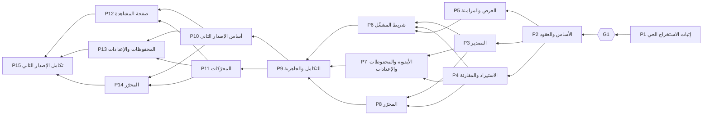

# الموجات وترتيب الدمج وملكية الملفات

> اشتُقت المراحل أولًا من احتياجات ترجمان ([مواصفة المنتج §١٤](../product-spec.md))، ثم نُظمت هنا في موجات بحسب الاعتماديات وملكية الملفات والعقود المشتركة. المراجع (نظام SS في رصد ولوحة فريمند) أمثلة لأسلوب العمل، لا قالب منقول؛ ولم تُغيَّر مراحل ترجمان لتطابقها. الجداول بين علامات `tj:gen` مولّدة من [`plan/plan.json`](../../plan/plan.json).

## الخلاصة

- **15 مرحلة في 8 موجات.** أقصى توازٍ: **3 مراحل** (في W3 وW4 وW7).
- **الإصدار الأول (W1–W5):**
  - **W1** وحدها: إثبات الاستخراج الحي، وبعدها البوابة **G1**. لا شيء يبدأ قبل حسمها.
  - **W2** وحدها: تثبيت العقود والهيكل، فتصبح W3 وW4 متوازيتين بلا ملفات مشتركة.
  - **W5** وحدها: الحكم التكاملي على الإصدار الأول، ثم الوسم `tj-v1`.
- **الإصدار الثاني (W6–W8، بقرار سلطان 2026-11-02):** ثلاث موجات فقط.
  - **W6** أساس وعقود ومحرّكات: مرحلتان معًا.
  - **W7** ثلاث واجهات معًا.
  - **W8** الحكم التكاملي، ثم الوسم `tj-v2`.
  - لا تُفصل مرحلة إلا لتوازٍ حقيقي أو تعارض ملفات أو اعتماد فعلي.

<!-- tj:gen:waves-table:start -->
| الموجة | ترتيب الدمج | التوازي | تعتمد على | البوابة | لماذا معًا |
| --- | --- | --- | --- | --- | --- |
| W1 — إثبات الاستخراج الحي | P1 | منفردة | — | npm run plan:check · npm run check · تحسم G1 | منفردة: أكبر خطر في المشروع، وبوابة قرار. لا يُبنى شيء فوق استخراج لم يثبت، ولا يجاورها عمل يمسّ ملفات الأساس التي تنشئها. |
| W2 — الأساس والعقود | P2 | منفردة | P1 | npm run plan:check · npm run check | منفردة: تثبّت العقود والهيكل ونقاط التركيب التي تبني عليها كل مراحل W3 وW4 بالتوازي. تمسّ manifest.json والبناء والمتحكم، فلا يجاورها أحد. |
| W3 — المنطق الأساسي والعرض | P3 ← P4 ← P5 | 3 معًا | P2 | npm run plan:check · npm run check:wave | ثلاث مراحل مستقلة فوق عقود P2 بملكيات لا تتقاطع: التصدير (extract وconvert وexport)، والاستيراد والمقارنة (srt وimport وcompare)، والعرض والمزامنة (player/overlay وsync وwatch). لا ملف مشترك بينها. P3 أولًا لأن بصمتها يستعملها اختبار الذهاب والإياب في P4. |
| W4 — واجهات الاستخدام | P6 ← P7 ← P8 | 3 معًا | P3 · P4 · P5 | npm run plan:check · npm run check:wave | ثلاث واجهات مستقلة تستهلك منطق W3 المدمج: شريط المشغّل مع تطبيق خط الترجمة وحجمها على الطبقة (player/controls وplayer/overlay)، والأيقونة والمحفوظات والإعدادات مع قالب تعليمات الترجمة (pages/popup وlibrary وsettings وcore/export/instructions)، والمحرّر (pages/editor وcore/edit). تسبقها «تهيئة W4» المسجّلة في docs/delivery/waves.md على main قبل وسمها، ثم العقود مجمّدة وأساس الواجهة src/ui مشترك للقراءة فقط. |
| W5 — التكامل والجاهزية للإصدار الأول | P9 | منفردة | P6 · P7 · P8 | npm run plan:check · npm run check:wave | منفردة: الحكم التكاملي النهائي على الإصدار الأول في المتصفحين، فيُغلق قبل أي عمل في الإصدار الثاني. نجاح كل فرع منفردًا ليس نجاح التكامل. |
| W6 — أساس الإصدار الثاني ومحرّكاته | P10 ← P11 | 2 معًا | P9 | npm run plan:check · npm run check:wave | مرحلتان مستقلتان فعلًا: P10 تملك كل ملف مشترك مجمّد يتغير في الإصدار الثاني (العقود، والنموذج، والتخزين، والمتحكم، والرسائل، وأساس الواجهة) وتثبت التوافق والرجوع إلى حزمة tj-v1؛ وP11 منطق نقي في مجلدات المجالات (المحاذاة، والاستيراد، والتصدير، ومحرّكات التحرير) لا يعتمد إلا على أنواع مجمّدة وواجهات ربط مثبتة في docs/delivery/waves.md قبل الموجة. لا تستهلك إحداهما شيفرة الأخرى فتعملان معًا، ثم تُجمَّد عقود الإصدار الثاني قبل W7. |
| W7 — واجهات الإصدار الثاني | P12 ← P13 ← P14 | 3 معًا | P10 · P11 | npm run plan:check · npm run check:wave | ثلاثة أسطح مستقلة تستهلك عقود W6 ومحرّكاتها المجمّدة: صفحة المشاهدة ونافذة الأيقونة (player/controls وpages/popup)، والمحفوظات والإعدادات مع النسخ الاحتياطي (pages/library وpages/settings وcore/backup)، والمحرّر (pages/editor وcore/edit). لا ملف مشترك بينها ولا عقد يتغير أثناءها، وما يربطها (الترجمة النشطة، والعلامات، والقاموس، والنسخة السابقة) يمر عبر التخزين والمتحكم كما ثبّتتهما P10، ويُختبر عبر الأسطح في البوابة. |
| W8 — التكامل والجاهزية للإصدار الثاني | P15 | منفردة | P12 · P13 · P14 | npm run plan:check · npm run check:wave | منفردة: الحكم التكاملي النهائي على رحلة المستخدم كاملة في المتصفحين وعلى الرجوع إلى الإصدار الأول. نجاح كل فرع منفردًا ليس نجاح التكامل. |
<!-- tj:gen:waves-table:end -->

## مخطط الاعتماديات



```text
W1: P1 ──G1──▶ W2: P2 ──▶ W3: P3 ║ P4 ║ P5 ──▶ W4: P6 ║ P7 ║ P8 ──▶ W5: P9 ──tj-v1
W6: P10 ║ P11 ──▶ W7: P12 ║ P13 ║ P14 ──▶ W8: P15 ──tj-v2
                                    (║ = بالتوازي في worktrees منفصلة)
```

## لماذا هذا الترتيب

| القرار | السبب |
| --- | --- |
| P1 وحدها أولًا | أكبر خطر، وطلب سلطان صريح أن تكون أول مرحلة تنفيذية. تنشئ ملفات الأساس، فلا يجاورها شيء. |
| لا عرض بالتوازي مع P1 | ممكن تقنيًا، لكنه يبني فوق عقود لم تستقر ويمسّ `manifest.json` و`package.json`، ويسبق قرار G1. القرار قابل للتغيير بطلب سلطان (Q9 في المواصفة). |
| P2 منفردة | العقود المشتركة لا تُكتب بالتوازي مع من يستهلكها. بعد P2 تُجمَّد. |
| P3 ║ P4 ║ P5 | منطق التصدير، ومنطق الاستيراد والمقارنة، والعرض: ملكيات منفصلة تمامًا فوق عقود مجمّدة. |
| P6 ║ P7 ║ P8 | ثلاث واجهات تستهلك منطق W3 المدمج، ولكلٍّ مجلدها. أساس `src/ui` للقراءة فقط. |
| P9 منفردة | نجاح كل فرع ليس نجاح التكامل. وتغلق الإصدار الأول قبل أي عمل في الثاني. |
| P10 ║ P11 | P10 تملك كل ملف مشترك مجمّد يتغير في الإصدار الثاني، وP11 منطق نقي في مجلدات المجالات. لا تستهلك إحداهما شيفرة الأخرى، وما بينهما (شكل مصطلح القاموس، وبند تقرير المراجعة، وتوقيعات المحرّكات) مثبت أدناه قبل الموجة. |
| P12 ║ P13 ║ P14 | ثلاثة أسطح بملكيات منفصلة فوق عقود W6 المجمّدة. فصلها للتوازي ولتعارض الملفات، لا للتقسيم الإداري؛ ولذلك المحرّر كله مرحلة واحدة لأن إضافاته في الملفات نفسها. |
| P15 منفردة | لا يُثبت تكامل الإصدار الثاني إلا بعد اجتماع الأسطح الثلاثة، ومعه الرجوع إلى `tj-v1`. |
| لماذا ثلاث موجات لا أربع | المنطق المشترك (المحاذاة والدمج الثلاثي) يُبنى في W6 بجانب الأساس لأنه لا يعتمد عليه، فلا تحتاج الواجهات موجة منطق مستقلة؛ والأسطح الثلاثة لا تتعارض فتجتمع في W7. |

## ترتيب الدمج داخل الموجات

- **W3: P3 ← P4 ← P5.** P3 أولًا لأن اختبار الذهاب والإياب في P4 يعمل بعدها على بصمتها الحقيقية. P5 لا تتقاطع مع أحد.
- **W4: P6 ← P7 ← P8.** P6 أولًا لأن دخان البوابة يبدأ من الشريط، ثم P7 لأن المحرّر يُفتح من المحفوظات.
- **W6: P10 ← P11.** P10 أولًا لأن عقودها تكتب توقيعات محرّكات P11؛ وبعد دمج P11 يتحقق المنسّق أن المنفَّذ مطابق للعقد.
- **W7: P12 ← P13 ← P14.** المشغّل أولًا لأن دخان البوابة يبدأ منه، ثم المحفوظات والإعدادات، ثم المحرّر الذي يستهلك في الدخان علامات المشغّل وخانات المحفوظات.
- الموجات المنفردة: مرحلة واحدة، لكنها تمر بالمنسّق أيضًا، فلا يتقدم `main` قبل بوابتها.

## ملكية الملفات لكل مرحلة

كل مرحلة تملك أيضًا ملفها في `docs/phases/` ومجلد أدلتها `docs/evidence/<ID>/`. داخل الموجة الواحدة لا يتقاطع ملك مرحلتين، ويفحص ذلك `npm run plan:check`.

<!-- tj:gen:ownership:start -->
**W1 — إثبات الاستخراج الحي**

| المرحلة | تملك |
| --- | --- |
| P1 — إثبات الاستخراج الحي | `package.json`، `package-lock.json`، `scripts/**`، `src/manifest.json`، `src/main-world/**`، `src/content/**`، `src/extract/**`، `src/core/convert/**`، `src/core/srt/**`، `src/core/diagnostics/**`، `src/pages/poc/**`، `test/unit/convert/**`، `test/unit/srt/**`، `test/unit/extract/**`، `test/unit/diagnostics/**`، `test/fixtures/json3/**`، `test/live/**`، `docs/contracts/extraction.md` |

**W2 — الأساس والعقود**

| المرحلة | تملك |
| --- | --- |
| P2 — الأساس والعقود والتخزين | `package.json`، `package-lock.json`، `scripts/**`، `src/manifest.json`، `src/content/**`، `src/core/model/**`، `src/core/store/**`، `src/core/errors/**`، `src/core/diagnostics/**`، `src/player/youtube-dom.js`، `src/player/overlay/index.js`، `src/player/controls/index.js`، `src/pages/**`، `src/ui/**`، `test/unit/model/**`، `test/unit/store/**`، `test/unit/content/**`، `test/helpers/**`، `test/live/harness/**`، `docs/contracts/**` |

**W3 — المنطق الأساسي والعرض**

| المرحلة | تملك |
| --- | --- |
| P3 — التصدير الإنتاجي | `src/extract/**`، `src/core/convert/**`، `src/core/export/**`، `src/core/errors/extract.js`، `test/unit/extract/**`، `test/unit/convert/**`، `test/unit/export/**`، `test/fixtures/json3/**` |
| P4 — الاستيراد والمقارنة | `src/core/srt/**`، `src/core/import/**`، `src/core/compare/**`، `src/core/errors/import.js`، `test/unit/srt/**`، `test/unit/import/**`، `test/unit/compare/**`، `test/fixtures/srt/**`، `test/integration/roundtrip/**` |
| P5 — طبقة العرض والمزامنة | `src/player/overlay/**`، `src/player/sync/**`، `src/player/watch/**`، `src/core/errors/overlay.js`، `test/unit/player/overlay/**`، `test/unit/player/sync/**`، `test/unit/player/watch/**`، `test/live/overlay/**` |

**W4 — واجهات الاستخدام**

| المرحلة | تملك |
| --- | --- |
| P6 — أدوات شريط المشغّل | `src/player/controls/**`، `src/player/overlay/**`، `src/core/errors/controls.js`، `test/unit/player/controls/**`، `test/unit/player/overlay/**`، `test/live/controls/**`، `test/integration/player/**` |
| P7 — الأيقونة والمحفوظات والإعدادات | `src/pages/popup/**`، `src/pages/library/**`، `src/pages/settings/**`، `src/core/errors/pages.js`، `src/core/export/instructions.js`، `src/core/export/index.js`، `test/unit/pages/popup/**`، `test/unit/pages/library/**`، `test/unit/pages/settings/**`، `test/unit/export/instructions.test.js`، `test/unit/export/build-export.test.js`، `test/live/pages/**` |
| P8 — محرّر الترجمة | `src/pages/editor/**`، `src/core/edit/**`، `src/core/errors/editor.js`، `test/unit/edit/**`، `test/unit/pages/editor/**`، `test/live/editor/**` |

**W5 — التكامل والجاهزية للإصدار الأول**

| المرحلة | تملك |
| --- | --- |
| P9 — التكامل الشامل والجاهزية | `test/e2e/**`، `scripts/release/**`، `docs/user-guide.md`، `docs/maintenance.md`، `docs/known-limitations.md` · إصلاحات موثّقة في `src/**` |

**W6 — أساس الإصدار الثاني ومحرّكاته**

| المرحلة | تملك |
| --- | --- |
| P10 — أساس الإصدار الثاني: العقود والتخزين المتوافق | `docs/contracts/data-model.md`، `docs/contracts/storage.md`، `docs/contracts/timing.md`، `docs/contracts/messages.md`، `docs/contracts/interfaces.md`، `docs/contracts/errors.md`، `docs/contracts/README.md`، `docs/contracts/backup.md`، `src/core/model/**`، `src/core/store/**`، `src/content/**`، `src/player/youtube-dom.js`، `src/ui/**`، `src/core/errors/index.js`، `src/core/errors/base.js`، `src/core/errors/backup.js`، `scripts/check-static.mjs`، `scripts/build.mjs`، `test/helpers/**`، `test/live/harness/**`، `test/unit/model/**`، `test/unit/store/**`، `test/unit/content/**`، `test/unit/ui/**`، `test/integration/compat/**`، `test/fixtures/v1/**`، `test/live/compat/**` |
| P11 — محرّكات الإصدار الثاني: المحاذاة والاستيراد والتصدير والتحرير | `src/core/align/**`، `src/core/compare/**`، `src/core/import/**`، `src/core/srt/**`، `src/core/export/**`، `src/core/edit/search.js`، `src/core/edit/structure.js`، `src/core/edit/drift.js`، `src/core/edit/density.js`، `src/core/errors/import.js`، `src/core/errors/extract.js`، `src/core/errors/editor.js`، `test/unit/align/**`، `test/unit/compare/**`، `test/unit/import/**`، `test/unit/srt/**`، `test/unit/export/**`، `test/unit/edit/engines/**`، `test/fixtures/srt/**`، `test/fixtures/v2/**`، `test/integration/roundtrip/**` |

**W7 — واجهات الإصدار الثاني**

| المرحلة | تملك |
| --- | --- |
| P12 — أدوات صفحة المشاهدة: الترجمات والمزامنة والتحميل | `src/player/controls/**`، `src/pages/popup/**`، `src/core/errors/controls.js`، `test/unit/player/controls/**`، `test/unit/pages/popup/**`، `test/live/controls/**`، `test/live/popup/**`، `test/integration/player/**` |
| P13 — المحفوظات والإعدادات: الترجمات والنسخ الاحتياطي والتنظيم | `src/pages/library/**`، `src/pages/settings/**`، `src/core/backup/**`، `src/core/errors/pages.js`، `src/core/errors/backup.js`، `test/unit/pages/library/**`، `test/unit/pages/settings/**`، `test/unit/backup/**`، `test/live/pages/**`، `test/integration/backup/**` |
| P14 — المحرّر: أدوات التحرير والمراجعة والاستكمال | `src/pages/editor/**`، `src/core/edit/**`، `src/core/errors/editor.js`، `test/unit/edit/**`، `test/unit/pages/editor/**`، `test/live/editor/**`، `test/integration/editor/**` |

**W8 — التكامل والجاهزية للإصدار الثاني**

| المرحلة | تملك |
| --- | --- |
| P15 — التكامل الشامل والجاهزية للإصدار الثاني | `test/e2e/**`، `scripts/release/**`، `docs/user-guide.md`، `docs/maintenance.md`، `docs/known-limitations.md` · إصلاحات موثّقة في `src/**` |
<!-- tj:gen:ownership:end -->

## الملفات المشتركة وقواعدها

<!-- tj:gen:shared:start -->
| الملف | تملكه في موجتها | القاعدة |
| --- | --- | --- |
| `plan/**` | المنسّق وحده | مصدر الخطة. لا تعدّله جلسة مرحلة؛ أي تعديل مطلوب يُكتب في sharedRequests ويطبّقه المنسّق. |
| `docs/product-spec.md` | المنسّق وحده | قرارات النطاق. تعديلها بقرار سلطان وعلى main فقط. |
| `docs/requirements-map.md` | المنسّق وحده | مولّد بـ npm run plan:render. لا يُحرَّر بيد. |
| `docs/delivery/**` | المنسّق وحده | قواعد التشغيل والموجات. يملكها المنسّق. |
| `docs/waves/**` | المنسّق وحده | سجلات الموجات. يكتبها منسّق الموجة وحده. |
| `docs/README.md` | المنسّق وحده | فهرس الوثائق. يملكه المنسّق. |
| `docs/contracts/extraction.md` | P1 · P2 | عقد الاستخراج. تحدّثه P1 بنتائجها الحية، وتثبّته P2، ثم يُجمَّد. |
| `docs/contracts/**` | P2 · P10 | العقود المشتركة. ثبّتتها P2، وتحدّثها P10 للإصدار الثاني في W6 بواجهات الربط المثبتة في docs/delivery/waves.md، ثم تُجمَّد ولا تتغير أثناء موجة متوازية؛ الحاجة إلى تغيير عقد تجعل المرحلة متعطلة حتى يحسمها المنسّق. |
| `.claude/**` | المنسّق وحده | المهارات وإعدادات التشغيل. يملكها المنسّق. |
| `tools/plan/**` | المنسّق وحده | أدوات المزامنة والفحص. يملكها المنسّق. |
| `dashboard/**` | المنسّق وحده | لوحة الخطة. يملكها المنسّق، وdashboard/data مولّد وغير متتبَّع. |
| `CLAUDE.md` | المنسّق وحده | تعليمات المشروع. يملكها المنسّق. |
| `README.md` | المنسّق وحده | يملكه المنسّق. |
| `figma-design-brief.md` | المنسّق وحده | مواصفة التصميم. تعديلها على main فقط. |
| `youtube-subtitles-research.md` | المنسّق وحده | تقرير مصدر. لا يُعدَّل أبدًا. |
| `tarjuman-research-plan.md` | المنسّق وحده | تقرير مصدر. لا يُعدَّل أبدًا. |
| `package.json` | P1 · P2 | تنشئ P1 سكربتات المنتج وتثبّتها P2. بعدها لا يُعدَّل إلا بطلب، وسكربتات plan:* لا تُحذف. |
| `package-lock.json` | P1 · P2 | يتبع package.json. |
| `scripts/**` | P1 · P2 · P10 | البناء والفحوص. تنشئها P1 وتثبّتها P2، وتعدّل P10 الفحص الثابت والبناء للإصدار الثاني، ثم بطلب. |
| `scripts/release/**` | P1 · P2 · P9 · P15 | سكربتات حزمة التثبيت الشخصي. تنشئها P9 في W5، وتحدّثها P15 للإصدار الثاني في W8، ولا يمسّها غيرهما. |
| `src/manifest.json` | P1 · P2 | تصرّح P2 بكل نقاط الدخول والأذونات مسبقًا، فلا تحتاج مراحل W3 وW4 لمسه. |
| `src/content/**` | P1 · P2 · P10 | نقطة دخول سكربت المحتوى والمتحكم والجسر والرسائل. ثبّتتها P2، وتوسّعها P10 للإصدار الثاني (الترجمات الثلاث والعلامات والقفز وحالة الأدوات)، ثم تُجمَّد. |
| `src/core/model/**` | P2 · P10 | نموذج البيانات المشترك. ثبّتته P2، وتضيف إليه P10 نماذج الإصدار الثاني دون تغيير أشكال الإصدار الأول، ثم يُجمَّد. |
| `src/core/errors/index.js` | P2 · P10 | يجمع ملفات أخطاء المجالات؛ كل مرحلة تملك ملف مجالها فقط، وتسجّل P10 مجالات الإصدار الثاني. |
| `src/player/youtube-dom.js` | P2 · P10 | محددات يوتيوب المعزولة. الإضافة إليها بطلب، أو في P10 للإصدار الثاني. |
| `src/ui/**` | P2 · P10 | أساس واجهات الصفحات. ترفع إليه P10 المكوّنات المشتركة للإصدار الثاني؛ والمكوّن الجديد بعدها يُبنى داخل صفحة مرحلته ثم يُرفع بطلب. |
| `test/helpers/**` | P2 · P10 | أدوات اختبار مشتركة، ومنها محاكيات عقود الإصدار الثاني (P10). |
| `test/live/harness/**` | P1 · P2 · P10 | حزام الاختبار الحي (تشغيل المتصفح وCDP). تنشئه P1 وتثبّته P2، وتضيف إليه P10 تحميل حزمة الإصدار الأول لاختبار الرجوع. |
<!-- tj:gen:shared:end -->

## نقاط تجميد العقود

| بعد | يُجمَّد | يُعدَّل بعدها |
| --- | --- | --- |
| W1 | سلوك الالتقاط الحي كما ثبت (`docs/contracts/extraction.md`) | P2 تثبّته فقط. |
| W2 | كل `docs/contracts/` و`src/core/model/` و`src/manifest.json` و`src/content/` و`src/ui/` و`src/player/youtube-dom.js` و`package.json` و`scripts/` | على `main` بين الموجات، بطلب مسجّل يطبّقه المنسّق. لا تغيير عقد أثناء موجة متوازية. |
| W3 | واجهات `export` و`import` و`compare` و`overlay` كما دُمجت | بطلب مسجّل، والمرحلة المحتاجة متعطلة حتى يُحسم. |
| قبل W6 | واجهات الربط للإصدار الثاني (أدناه) | تكتبها P10 في العقود كما هي، وتنفّذها P11 كما هي؛ والانحراف طلب مسجّل يحسمه المنسّق. |
| W6 | عقود الإصدار الثاني كلها: التخزين المتوافق ومفاتيحه الجديدة، ونماذج الترجمات الثلاث والنسخة السابقة والعلامات والتفضيلات، والمتحكم والرسائل، وتوقيعات المحرّكات، وأساس الواجهة | على `main` بين الموجات بطلب مسجّل. لا تغيير عقد أثناء W7. |

## واجهات الربط للإصدار الثاني (مثبتة قبل W6)

> ثُبّتت مع الخطة (2026-11-02) لتعمل P10 وP11 بالتوازي دون أن تنتظر إحداهما الأخرى، ولتعرف مراحل W7 ما ستستهلكه. تكتبها P10 في `docs/contracts/interfaces.md` كما هي، وتنفّذ P11 توقيعاتها كما هي. أي حاجة إلى تغييرها طلب مسجّل، والمرحلة متعطلة حتى يحسمه المنسّق. الأنواع غير المذكورة هنا (المقطع، والبصمة، والمسار الإنجليزي، وتقرير المقارنة) كما في عقد البيانات المجمّد.

**أشكال يتبادلها الطرفان:**

- **مصطلح القاموس:** `{ source: string (1..80), target: string (1..80), note: string | null (≤120) }`، والقاموس حتى 100 مصطلح. تحفظه P10 في تفضيلات الإصدار الثاني، وتستهلكه `instructions` في P11.
- **بند تقرير المراجعة:** `{ n, startMs, endMs, problems: string[] (رموز), mark: 'todo' | 'done' | null, text: string | null, english: string | null }`. يبنيه المحرّر (P14) من لوحة المراجعة، ويكتبه `buildReviewReport` في P11.

**محرّكات P11 (منطق نقي، لا DOM ولا تخزين):**

```js
// src/core/align
alignCues(a: Cue[], b: Cue[], opts?) → { pairs: { a: number | null, b: number | null }[], confidence: 'high' | 'low', reasons: string[] }
diffTranslations(current: Cue[], incoming: Cue[], opts?) → { aligned: boolean, confidence, counts: { textChanged, timingChanged, added, removed, unchanged }, changes: { n, kind, before, after }[] }
mergeThreeWay({ base, mine, theirs }: { base: Cue[], mine: Cue[], theirs: Cue[] }, opts?)
  → { ok: true, cues: Cue[], kept: number[], taken: number[], conflicts: { n, mine, theirs }[] } | { ok: false, reason: string }

// src/core/compare
rankReferences(cues: Cue[], fingerprints: Fingerprint[]) → { fingerprintId, score, matched, why }[]   // الأفضل أولًا
compare(...)   // التوقيع نفسه؛ restoreTimingAvailable لا يصح إلا بمحاذاة متحققة، والسبب في notes

// src/core/import (وsrc/core/srt بالتوقيع نفسه، مع Markdown)
reviewIncoming({ fileName, cues, videoId, fingerprints, knownVideoIds? })
  → { references: ReturnType<rankReferences>, suggested: string | null, certain: boolean, nameHint: null | { videoId: string, differs: boolean } }
readPatch(fileOrFiles, { fingerprint, cues }) → Promise<{ ok: true, plan } | { ok: false, error: { code, message, line? } }>
applyPatch(cues: Cue[], plan, { only?: number[] }) → Cue[]

// src/core/export
instructions({ videoId, title, parts?, glossary? }) → string            // glossary: مصطلحات القاموس أعلاه
planPartsByContent(cues: Cue[], size: number) → { index, from, to }[] | null   // planParts القديم باقٍ
buildPatchPackage({ videoId, title, fingerprint, englishTracks, numbers }) → { ok: true, file: { name, text }, instructions: string, count } | { ok: false, code }
buildStudyText({ videoId, title, cues, english?, format: 'txt' | 'md', bilingual: boolean }) → { name, text }
buildReviewReport({ videoId, title, items, includeText: boolean, format: 'txt' | 'md' }) → { name, text }   // items: بنود التقرير أعلاه

// src/core/edit (ملفات المحرّكات الجديدة فقط)
searchCues(cues, query, { field: 'ar' | 'en', english?, wholeWord, ignoreMarks }) → { index, start, end }[]
planReplace(cues, matches, replacement, { only?: number[] }) → { changes: { index, n, before, after }[] }
mergeCues(cues, index) → Cue[] · splitCue(cues, index, at) → Cue[]
driftCorrect(cues, { a: { n, toMs }, b: { n, toMs } }) → { ok: true, cues } | { ok: false, negative: number[] }
readingMetrics(cue) → { cps: number, longestLine: number }
```

**ما تثبّته P10 داخل W6 وتستهلكه W7:** واجهة التخزين بالتوابع وواجهة الاستعادة، وأفعال المتحكم وحالته الجديدة، ورسالة القفز وأداة الصفحات، وحلّ ارتباط العلامات، وصيغة النسخة الاحتياطية. تُجمَّد كلها ببوابة W6 قبل أن تبدأ W7.

## اختبارات التكامل المشتركة

نجاح اختبارات كل مرحلة وحدها لا يكفي. ما يربط مرحلتين أو أكثر يُختبر بعد دمجهما في بوابة الموجة: يكتبه المنسّق سكربت دخان في `docs/evidence/<WAVE>/` (كما في W4)، وتحوّله P15 إلى اختبارات دائمة في `test/e2e/`. ولكل مرحلة محاكيات العقد في `test/helpers` (من P10) لتختبر جانبها قبل الدمج.

| الموجة | ما يُختبر مشتركًا |
| --- | --- |
| W6 | الرجوع إلى حزمة `tj-v1` حيًا (الأول ← الثاني ← الأول ← الثاني دون فقد) · القاموس من تفضيلات P10 عبر `instructions` في P11 · `reviewIncoming` على بصمات من واجهة التخزين، و`diffTranslations` على ترجمتين من خانتين · رسالة القفز تصل تبويبًا مفتوحًا. |
| W7 | تفعيل الترجمة بين المحفوظات والمشغّل بالاتجاهين · الحفظ في خانة غير نشطة لا يغيّر المعروض · أعداد الاستبدال نفسها في المشغّل والمحفوظات · علامة المشغّل في المحرّر وفي الفرز · القاموس بالنص نفسه من الموضعين · ملف تصحيح من المحرّر يظهر في المشغّل · نسخة احتياطية تشمل ما أنشأته الأسطح الثلاثة وتُستعاد بافتراض التخطي · القفز من المحرّر إلى المشغّل. |
| W8 | الرحلة الكاملة على المتصفحين، والرجوع بالحزمة الحقيقية، ومسارات الإلغاء والتعارض ببصمة التخزين (P15). |

## طلبات مسجّلة بين الموجات

### قبل وسم W6 — الإصدار الأول

> **ينفّذه منسّق W5** بعد تحقق الموجة وتقديم `main`، وقبل `git tag tj-W6/base`. وثائق ووسوم فقط، بلا شيفرة.

1. الوسم `tj-v1` على `main` المتحقق، ودفعه بالاسم (`git push origin refs/tags/tj-v1`). هو الإصدار الأول الذي يُرجع إليه، وتُبنى منه حزمة اختبار التوافق في P10 وP15.
2. **منفّذ (2026-11-02):** اعتمد سلطان فقرة «مصطلحات مفضّلة» (إضافة الملحق أ) و«تعليمات الاستكمال» (الملحق ب) في [المواصفة](../product-spec.md) (القرار Q11)، وتبنيهما P11 حرفيًا. يتحقق المنسّق فقط من أن المواصفة تحملهما معتمدين.
3. ثم الوسم `tj-W6/base`.

### تهيئة W4 — عقود المظهر وتعليمات الترجمة وخطوط الترجمة

> **منفّذة** (2026-11-02، منسّق W3) في التزام «W4: تهيئة — عقود المظهر وتعليمات الترجمة وخطوط الترجمة» على `main`، وعليه الوسم `tj-W4/base`. الخطوط من مستودع `google/fonts` عند `6c1dbe27dcf7` بموافقة سلطان: `Almarai-Regular.ttf` و`Almarai-Bold.ttf` و`Tajawal-Regular.ttf` و`Tajawal-Bold.ttf` كما هي، و`NotoSansArabic[wdth,wght].ttf` و`MarkaziText[wght].ttf` المتغيران مثبّتين عند `wght` 400 و700 (و`wdth` 100) بـfontTools 4.60.2، ثم WOFF2 بلا تقليص للحروف، ومع كلٍّ `OFL.txt` عائلته باسم `‹المعرّف›-OFL.txt`. والحجم القديم يُقرأ نسبة (`appearance.size`) ولا يُكتب، ولم يُرفع إصدار مخطط الإعدادات. والطبقة على `main` تعرض بحجم 100% وخط النظام حتى تطبّق P6 الخط والحجم (`layout.js` يرجع إلى 1 عند غياب `size`).

**الطلب:** اعتمده سلطان في 2026-11-01 مع إضافة «نسخ تعليمات الترجمة» وخط الترجمة وحجمها و«حول ترجمان» (R40 وR41 وR42). **ينفّذه منسّق W3** على `main` بعد تقديمه إلى `tj-int/W3` المتحقق، و**قبل** `git tag tj-W4/base` (الخطوة 9 من «دور: منسّق الموجة»)، فتبدأ فروع W4 منه. لا يُنفَّذ قبل ذلك: العقود لا تتغير أثناء موجة لم تُغلق.

1. **نموذج الإعدادات:** `docs/contracts/data-model.md` §٨ و`src/core/model/settings.js` واختبارها في `test/unit/model/`:
   - `appearance.font`: `"almarai" | "noto-sans-arabic" | "tajawal" | "markazi"`، والافتراضي `almarai`.
   - `appearance.scale` بدل `appearance.size`: عدد صحيح من 70 إلى 160 من مضاعفات 5، والافتراضي 100. والقراءة المتسامحة تحوّل القيم القديمة: `s` إلى 85، و`m` إلى 100، و`l` إلى 120، و`xl` إلى 145.
   - حذف `export.showInstructions`: التعليمات لا تُعرض في الواجهة أبدًا.
2. **عقد الواجهات:** `docs/contracts/interfaces.md`:
   - وحدة التصدير: `instructions({ videoId, title, parts? }) → string` بنص [الملحق أ في مواصفة المنتج](../product-spec.md#ملحق-أ-تعليمات-الترجمة-المعتمدة) حرفيًا، و`buildExport` يمرّر عنوانه ومعرّفه. تنفّذه P7.
   - الطبقة: المظهر من `state.settings.appearance` بما فيه الخط والحجم النسبي، والخطوط من ملفات الإضافة. تنفّذه P6.
3. **بيانات الخطوط:** `src/ui/subtitle-fonts.js` (بيانات فقط): لكل خط معرّفه، واسمه العربي، واسم عائلة فريد داخل الإضافة، وملفاه، وسلسلة البدائل (المراعي المضمّن، ثم خطوط النظام العربية).
4. **ملفات الخطوط:** `src/ui/fonts/subtitle/`: WOFF2 للخطوط الأربعة بوزنين (700 و400) مع `OFL.txt` لكل عائلة، من مستودع Google Fonts الرسمي. **التنزيل بموافقة سلطان عند التنفيذ**، مع ذكر الملفات ومصدرها وحجمها.
5. **البيان والبناء:**
   - `src/manifest.json`: `web_accessible_resources` لملفات `ui/fonts/subtitle/*.woff2` وحدها، على `https://www.youtube.com/*`، مع `use_dynamic_url: true`. لا أذونات جديدة.
   - `scripts/build.mjs`: نسخ `ui/fonts/**` إلى البناء.
   - `scripts/check-static.mjs`: قبول هذا الإدخال وحده في البيان.
6. **الوثائق:** إزالة هذا البند من «طلبات مسجّلة» أو وسمه «منفّذ» مع بصمة الالتزام، وتحديث `CLAUDE.md` إن لزم.
7. **الفحص والالتزام:** `npm run check` و`npm run plan:check` خضراوان، ثم التزام `W4: تهيئة — عقود المظهر وتعليمات الترجمة وخطوط الترجمة`، ثم الوسم والدفع بقواعد «الحفظ والدفع».

## إن فشل الاستخراج عند G1

يدمج منسّق W1 فرع P1 (التقرير والشيفرة دليل)، ويثبّت نتيجتها، ثم **يتوقف**: يعرض الأسباب والبدائل وخيارات البوابة، ولا يضع وسم W2 قبل قرار سلطان المكتوب. الخيارات في `plan.json`: المضي بالنطاق الذي ثبت فقط، أو مرحلة بحث إضافية في طريقة لا تتجاوز الحماية، أو الإيقاف المؤقت، أو المضي في العارض والمحرّر دون الاستخراج بقرار صريح. لا يتحول المشروع تلقائيًا إلى «عارض SRT».
