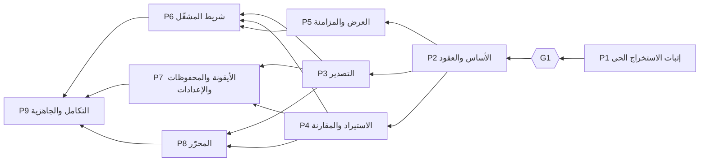

# الموجات وترتيب الدمج وملكية الملفات

> اشتُقت المراحل أولًا من احتياجات ترجمان ([مواصفة المنتج §١٤](../product-spec.md))، ثم نُظمت هنا في موجات بحسب الاعتماديات وملكية الملفات والعقود المشتركة. المراجع (نظام SS في رصد ولوحة فريمند) أمثلة لأسلوب العمل، لا قالب منقول؛ ولم تُغيَّر مراحل ترجمان لتطابقها. الجداول بين علامات `tj:gen` مولّدة من [`plan/plan.json`](../../plan/plan.json).

## الخلاصة

- **9 مراحل في 5 موجات.** أقصى توازٍ: **3 مراحل** (في W3 ثم W4).
- **W1** وحدها: إثبات الاستخراج الحي، وبعدها البوابة **G1**. لا شيء يبدأ قبل حسمها.
- **W2** وحدها: تثبيت العقود والهيكل، فتصبح W3 وW4 متوازيتين بلا ملفات مشتركة.
- **W5** وحدها: الحكم التكاملي النهائي.

<!-- tj:gen:waves-table:start -->
| الموجة | ترتيب الدمج | التوازي | تعتمد على | البوابة | لماذا معًا |
| --- | --- | --- | --- | --- | --- |
| W1 — إثبات الاستخراج الحي | P1 | منفردة | — | npm run plan:check · npm run check · تحسم G1 | منفردة: أكبر خطر في المشروع، وبوابة قرار. لا يُبنى شيء فوق استخراج لم يثبت، ولا يجاورها عمل يمسّ ملفات الأساس التي تنشئها. |
| W2 — الأساس والعقود | P2 | منفردة | P1 | npm run plan:check · npm run check | منفردة: تثبّت العقود والهيكل ونقاط التركيب التي تبني عليها كل مراحل W3 وW4 بالتوازي. تمسّ manifest.json والبناء والمتحكم، فلا يجاورها أحد. |
| W3 — المنطق الأساسي والعرض | P3 ← P4 ← P5 | 3 معًا | P2 | npm run plan:check · npm run check:wave | ثلاث مراحل مستقلة فوق عقود P2 بملكيات لا تتقاطع: التصدير (extract وconvert وexport)، والاستيراد والمقارنة (srt وimport وcompare)، والعرض والمزامنة (player/overlay وsync وwatch). لا ملف مشترك بينها. P3 أولًا لأن بصمتها يستعملها اختبار الذهاب والإياب في P4. |
| W4 — واجهات الاستخدام | P6 ← P7 ← P8 | 3 معًا | P3 · P4 · P5 | npm run plan:check · npm run check:wave | ثلاث واجهات مستقلة تستهلك منطق W3 المدمج: شريط المشغّل مع تطبيق خط الترجمة وحجمها على الطبقة (player/controls وplayer/overlay)، والأيقونة والمحفوظات والإعدادات مع قالب تعليمات الترجمة (pages/popup وlibrary وsettings وcore/export/instructions)، والمحرّر (pages/editor وcore/edit). تسبقها «تهيئة W4» المسجّلة في docs/delivery/waves.md على main قبل وسمها، ثم العقود مجمّدة وأساس الواجهة src/ui مشترك للقراءة فقط. |
| W5 — التكامل والجاهزية | P9 | منفردة | P6 · P7 · P8 | npm run plan:check · npm run check:wave | منفردة: الحكم التكاملي النهائي على المتصفحين. نجاح كل فرع منفردًا ليس نجاح التكامل. |
<!-- tj:gen:waves-table:end -->

## مخطط الاعتماديات



```text
W1: P1 ──G1──▶ W2: P2 ──▶ W3: P3 ║ P4 ║ P5 ──▶ W4: P6 ║ P7 ║ P8 ──▶ W5: P9
                                    (║ = بالتوازي في worktrees منفصلة)
```

## لماذا هذا الترتيب

| القرار | السبب |
| --- | --- |
| P1 وحدها أولًا | أكبر خطر، وطلب سلطان صريح أن تكون أول مرحلة تنفيذية. تنشئ ملفات الأساس، فلا يجاورها شيء. |
| لا عرض بالتوازي مع P1 | ممكن تقنيًا، لكنه يبني فوق عقود لم تستقر ويمسّ `manifest.json` و`package.json`، ويسبق قرار G1. القرار قابل للتغيير بطلب سلطان (Q9 في المواصفة). |
| P2 منفردة | العقود المشتركة لا تُكتب بالتوازي مع من يستهلكها. بعد P2 تُجمَّد. |
| P3 ║ P4 ║ P5 | منطق التصدير، ومنطق الاستيراد والمقارنة، والعرض: ملكيات منفصلة تمامًا فوق عقود مجمّدة. |
| P6 ║ P7 ║ P8 | ثلاث واجهات تستهلك منطق W3 المدمج، ولكلٍّ مجلدها. أساس `src/ui` للقراءة فقط. |
| P9 منفردة | نجاح كل فرع ليس نجاح التكامل. |

## ترتيب الدمج داخل الموجات

- **W3: P3 ← P4 ← P5.** P3 أولًا لأن اختبار الذهاب والإياب في P4 يعمل بعدها على بصمتها الحقيقية. P5 لا تتقاطع مع أحد.
- **W4: P6 ← P7 ← P8.** P6 أولًا لأن دخان البوابة يبدأ من الشريط، ثم P7 لأن المحرّر يُفتح من المحفوظات.
- الموجات المنفردة: مرحلة واحدة، لكنها تمر بالمنسّق أيضًا، فلا يتقدم `main` قبل بوابتها.

## ملكية الملفات لكل مرحلة

كل مرحلة تملك أيضًا ملفها في `docs/phases/` ومجلد أدلتها `docs/evidence/<ID>/`. داخل الموجة الواحدة لا يتقاطع ملك مرحلتين، ويفحص ذلك `npm run plan:check`.

<!-- tj:gen:ownership:start -->
**W1 — إثبات الاستخراج الحي**

| المرحلة | تملك |
| --- | --- |
| P1 — إثبات الاستخراج الحي | `package.json`، `package-lock.json`، `scripts/**`، `src/manifest.json`، `src/main-world/**`، `src/content/**`، `src/extract/**`، `src/core/convert/**`، `src/core/srt/**`، `src/core/diagnostics/**`، `src/pages/poc/**`، `test/unit/convert/**`، `test/unit/srt/**`، `test/unit/extract/**`، `test/unit/diagnostics/**`، `test/fixtures/json3/**`، `test/live/**`، `docs/contracts/extraction.md` |

**W2 — الأساس والعقود**

| المرحلة | تملك |
| --- | --- |
| P2 — الأساس والعقود والتخزين | `package.json`، `package-lock.json`، `scripts/**`، `src/manifest.json`، `src/content/**`، `src/core/model/**`، `src/core/store/**`، `src/core/errors/**`، `src/core/diagnostics/**`، `src/player/youtube-dom.js`، `src/player/overlay/index.js`، `src/player/controls/index.js`، `src/pages/**`، `src/ui/**`، `test/unit/model/**`، `test/unit/store/**`، `test/unit/content/**`، `test/helpers/**`، `test/live/harness/**`، `docs/contracts/**` |

**W3 — المنطق الأساسي والعرض**

| المرحلة | تملك |
| --- | --- |
| P3 — التصدير الإنتاجي | `src/extract/**`، `src/core/convert/**`، `src/core/export/**`، `src/core/errors/extract.js`، `test/unit/extract/**`، `test/unit/convert/**`، `test/unit/export/**`، `test/fixtures/json3/**` |
| P4 — الاستيراد والمقارنة | `src/core/srt/**`، `src/core/import/**`، `src/core/compare/**`، `src/core/errors/import.js`، `test/unit/srt/**`، `test/unit/import/**`، `test/unit/compare/**`، `test/fixtures/srt/**`، `test/integration/roundtrip/**` |
| P5 — طبقة العرض والمزامنة | `src/player/overlay/**`، `src/player/sync/**`، `src/player/watch/**`، `src/core/errors/overlay.js`، `test/unit/player/overlay/**`، `test/unit/player/sync/**`، `test/unit/player/watch/**`، `test/live/overlay/**` |

**W4 — واجهات الاستخدام**

| المرحلة | تملك |
| --- | --- |
| P6 — أدوات شريط المشغّل | `src/player/controls/**`، `src/player/overlay/**`، `src/core/errors/controls.js`، `test/unit/player/controls/**`، `test/unit/player/overlay/**`، `test/live/controls/**`، `test/integration/player/**` |
| P7 — الأيقونة والمحفوظات والإعدادات | `src/pages/popup/**`، `src/pages/library/**`، `src/pages/settings/**`، `src/core/errors/pages.js`، `src/core/export/instructions.js`، `src/core/export/index.js`، `test/unit/pages/popup/**`، `test/unit/pages/library/**`، `test/unit/pages/settings/**`، `test/unit/export/instructions.test.js`، `test/unit/export/build-export.test.js`، `test/live/pages/**` |
| P8 — محرّر الترجمة | `src/pages/editor/**`، `src/core/edit/**`، `src/core/errors/editor.js`، `test/unit/edit/**`، `test/unit/pages/editor/**`، `test/live/editor/**` |

**W5 — التكامل والجاهزية**

| المرحلة | تملك |
| --- | --- |
| P9 — التكامل الشامل والجاهزية | `test/e2e/**`، `scripts/release/**`، `docs/user-guide.md`، `docs/maintenance.md`، `docs/known-limitations.md` · إصلاحات موثّقة في `src/**` |
<!-- tj:gen:ownership:end -->

## الملفات المشتركة وقواعدها

<!-- tj:gen:shared:start -->
| الملف | تملكه في موجتها | القاعدة |
| --- | --- | --- |
| `plan/**` | المنسّق وحده | مصدر الخطة. لا تعدّله جلسة مرحلة؛ أي تعديل مطلوب يُكتب في sharedRequests ويطبّقه المنسّق. |
| `docs/product-spec.md` | المنسّق وحده | قرارات النطاق. تعديلها بقرار سلطان وعلى main فقط. |
| `docs/requirements-map.md` | المنسّق وحده | مولّد بـ npm run plan:render. لا يُحرَّر بيد. |
| `docs/delivery/**` | المنسّق وحده | قواعد التشغيل والموجات. يملكها المنسّق. |
| `docs/waves/**` | المنسّق وحده | سجلات الموجات. يكتبها منسّق الموجة وحده. |
| `docs/README.md` | المنسّق وحده | فهرس الوثائق. يملكه المنسّق. |
| `docs/contracts/extraction.md` | P1 · P2 | عقد الاستخراج. تحدّثه P1 بنتائجها الحية، وتثبّته P2، ثم يُجمَّد. |
| `docs/contracts/**` | P2 | العقود المشتركة. تثبّتها P2، ثم تُجمَّد ولا تتغير أثناء موجة متوازية؛ الحاجة إلى تغيير عقد تجعل المرحلة متعطلة حتى يحسمها المنسّق. |
| `.claude/**` | المنسّق وحده | المهارات وإعدادات التشغيل. يملكها المنسّق. |
| `tools/plan/**` | المنسّق وحده | أدوات المزامنة والفحص. يملكها المنسّق. |
| `dashboard/**` | المنسّق وحده | لوحة الخطة. يملكها المنسّق، وdashboard/data مولّد وغير متتبَّع. |
| `CLAUDE.md` | المنسّق وحده | تعليمات المشروع. يملكها المنسّق. |
| `README.md` | المنسّق وحده | يملكه المنسّق. |
| `figma-design-brief.md` | المنسّق وحده | مواصفة التصميم. تعديلها على main فقط. |
| `youtube-subtitles-research.md` | المنسّق وحده | تقرير مصدر. لا يُعدَّل أبدًا. |
| `tarjuman-research-plan.md` | المنسّق وحده | تقرير مصدر. لا يُعدَّل أبدًا. |
| `package.json` | P1 · P2 | تنشئ P1 سكربتات المنتج وتثبّتها P2. بعدها لا يُعدَّل إلا بطلب، وسكربتات plan:* لا تُحذف. |
| `package-lock.json` | P1 · P2 | يتبع package.json. |
| `scripts/**` | P1 · P2 | البناء والفحوص. تنشئها P1 وتثبّتها P2، ثم بطلب. |
| `scripts/release/**` | P1 · P2 · P9 | سكربتات حزمة التثبيت الشخصي. تنشئها P9 في W5، ولا يمسّها غيرها بعد W2. |
| `src/manifest.json` | P1 · P2 | تصرّح P2 بكل نقاط الدخول والأذونات مسبقًا، فلا تحتاج مراحل W3 وW4 لمسه. |
| `src/content/**` | P1 · P2 | نقطة دخول سكربت المحتوى والمتحكم والجسر. تثبّتها P2. |
| `src/core/model/**` | P2 | نموذج البيانات المشترك. يُجمَّد بعد P2. |
| `src/core/errors/index.js` | P2 | يجمع ملفات أخطاء المجالات؛ كل مرحلة تملك ملف مجالها فقط. |
| `src/player/youtube-dom.js` | P2 | محددات يوتيوب المعزولة. الإضافة إليها بطلب. |
| `src/ui/**` | P2 | أساس واجهات الصفحات. المكوّن الجديد يُبنى داخل صفحة مرحلته ثم يُرفع بطلب. |
| `test/helpers/**` | P2 | أدوات اختبار مشتركة. |
| `test/live/harness/**` | P1 · P2 | حزام الاختبار الحي (تشغيل المتصفح وCDP). تنشئه P1 وتثبّته P2. |
<!-- tj:gen:shared:end -->

## نقاط تجميد العقود

| بعد | يُجمَّد | يُعدَّل بعدها |
| --- | --- | --- |
| W1 | سلوك الالتقاط الحي كما ثبت (`docs/contracts/extraction.md`) | P2 تثبّته فقط. |
| W2 | كل `docs/contracts/` و`src/core/model/` و`src/manifest.json` و`src/content/` و`src/ui/` و`src/player/youtube-dom.js` و`package.json` و`scripts/` | على `main` بين الموجات، بطلب مسجّل يطبّقه المنسّق. لا تغيير عقد أثناء موجة متوازية. |
| W3 | واجهات `export` و`import` و`compare` و`overlay` كما دُمجت | بطلب مسجّل، والمرحلة المحتاجة متعطلة حتى يُحسم. |

## طلبات مسجّلة بين الموجات

### تهيئة W4 — عقود المظهر وتعليمات الترجمة وخطوط الترجمة

**الطلب:** اعتمده سلطان في 2026-11-01 مع إضافة «نسخ تعليمات الترجمة» وخط الترجمة وحجمها و«حول ترجمان» (R40 وR41 وR42). **ينفّذه منسّق W3** على `main` بعد تقديمه إلى `tj-int/W3` المتحقق، و**قبل** `git tag tj-W4/base` (الخطوة 9 من «دور: منسّق الموجة»)، فتبدأ فروع W4 منه. لا يُنفَّذ قبل ذلك: العقود لا تتغير أثناء موجة لم تُغلق.

1. **نموذج الإعدادات:** `docs/contracts/data-model.md` §٨ و`src/core/model/settings.js` واختبارها في `test/unit/model/`:
   - `appearance.font`: `"almarai" | "noto-sans-arabic" | "tajawal" | "markazi"`، والافتراضي `almarai`.
   - `appearance.scale` بدل `appearance.size`: عدد صحيح من 70 إلى 160 من مضاعفات 5، والافتراضي 100. والقراءة المتسامحة تحوّل القيم القديمة: `s` إلى 85، و`m` إلى 100، و`l` إلى 120، و`xl` إلى 145.
   - حذف `export.showInstructions`: التعليمات لا تُعرض في الواجهة أبدًا.
2. **عقد الواجهات:** `docs/contracts/interfaces.md`:
   - وحدة التصدير: `instructions({ videoId, title, parts? }) → string` بنص [الملحق أ في مواصفة المنتج](../product-spec.md#ملحق-أ-تعليمات-الترجمة-المعتمدة) حرفيًا، و`buildExport` يمرّر عنوانه ومعرّفه. تنفّذه P7.
   - الطبقة: المظهر من `state.settings.appearance` بما فيه الخط والحجم النسبي، والخطوط من ملفات الإضافة. تنفّذه P6.
3. **بيانات الخطوط:** `src/ui/subtitle-fonts.js` (بيانات فقط): لكل خط معرّفه، واسمه العربي، واسم عائلة فريد داخل الإضافة، وملفاه، وسلسلة البدائل (المراعي المضمّن، ثم خطوط النظام العربية).
4. **ملفات الخطوط:** `src/ui/fonts/subtitle/`: WOFF2 للخطوط الأربعة بوزنين (700 و400) مع `OFL.txt` لكل عائلة، من مستودع Google Fonts الرسمي. **التنزيل بموافقة سلطان عند التنفيذ**، مع ذكر الملفات ومصدرها وحجمها.
5. **البيان والبناء:**
   - `src/manifest.json`: `web_accessible_resources` لملفات `ui/fonts/subtitle/*.woff2` وحدها، على `https://www.youtube.com/*`، مع `use_dynamic_url: true`. لا أذونات جديدة.
   - `scripts/build.mjs`: نسخ `ui/fonts/**` إلى البناء.
   - `scripts/check-static.mjs`: قبول هذا الإدخال وحده في البيان.
6. **الوثائق:** إزالة هذا البند من «طلبات مسجّلة» أو وسمه «منفّذ» مع بصمة الالتزام، وتحديث `CLAUDE.md` إن لزم.
7. **الفحص والالتزام:** `npm run check` و`npm run plan:check` خضراوان، ثم التزام `W4: تهيئة — عقود المظهر وتعليمات الترجمة وخطوط الترجمة`، ثم الوسم والدفع بقواعد «الحفظ والدفع».

## إن فشل الاستخراج عند G1

يدمج منسّق W1 فرع P1 (التقرير والشيفرة دليل)، ويثبّت نتيجتها، ثم **يتوقف**: يعرض الأسباب والبدائل وخيارات البوابة، ولا يضع وسم W2 قبل قرار سلطان المكتوب. الخيارات في `plan.json`: المضي بالنطاق الذي ثبت فقط، أو مرحلة بحث إضافية في طريقة لا تتجاوز الحماية، أو الإيقاف المؤقت، أو المضي في العارض والمحرّر دون الاستخراج بقرار صريح. لا يتحول المشروع تلقائيًا إلى «عارض SRT».
