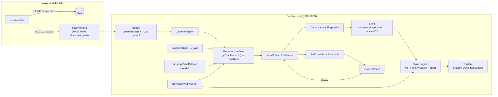

# خطة تنفيذ إضافة ترجمة يوتيوب العربية: مراجعة، بحث استخراج، وتصميم نسخة أولى

الحكم: امضِ في المشروع، لكن بنطاق مشروط. شق العرض (استيراد SRT عربي وعرضه فوق الفيديو مع ضبط التوقيت والحفظ لكل فيديو) قابل للبناء بثقة معقولة. أما شق استخراج الترجمة الإنجليزية فلا توجد له اليوم طريقة موثوقة ومضمونة ومشروعة بلا تحفظ. الطريقة المرشحة هي التقاط الاستجابة التي يجلبها مشغّل يوتيوب نفسه بعد أن يفعّل المستخدم الترجمة، ويجب إثبات جدواها في متصفح حي قبل بناء أي واجهة كاملة.

## TL;DR

- **الاستخراج هو الخطر الأكبر.** منذ 2025 يُرجع رابط `baseUrl` المأخوذ من `ytInitialPlayerResponse` في حالات متزايدة استجابة `200` بجسم فارغ إن حمل `exp=xpe` ولم يُرفق به رمز `pot` الذي يولّده المشغّل. الطريقة الوحيدة المقبولة ضمن قيودك هي قراءة استجابة `/api/timedtext` التي طلبها المشغّل بنفسه بعد تفعيلك الترجمة. البديل الأضعف لوحة «إظهار النص»، وتوقيتها بداية فقط وبدقة الثانية.
- **تقرير `youtube-subtitles-research.md` يحتاج تصحيحات جوهرية.** الطريقة 4 (InnerTube بعميل `ANDROID`/`IOS`) انتحال عميل فتُستبعد. وادعاءات «متوافقة مع المتجر» و«500–700 سطر» و«يغطي 80%» غير مسندة. والقصّ `end = min(end, next.start)` لا يثبت عدم فقد الكلمات. وبعض أرقام issues في asbplayer نُسبت إلى غير موضوعها.
- **ابدأ بإثبات جدوى مدته أيام قليلة** بشرط إيقاف واضح: إن فشل الالتقاط على فيديو يدوي وآخر تلقائي، أو ظهر التقاط لترجمة فيديو سابق ولم يُعالج، يتحول المنتج إلى «عارض SRT مستورد» فقط.

---

## 1) ملخص تنفيذي

**هل نمضي؟** نعم، على مرحلتين مستقلتين:

1. **العارض** (استيراد، عرض آمن، مزامنة، تقديم وتأخير، حفظ لكل فيديو، مقارنة). لا يعتمد على واجهة غير موثقة في يوتيوب سوى بنية DOM للمشغّل، وقيمته قائمة حتى لو فشل الاستخراج كليًا.
2. **المستخرِج.** وحدة مستقلة قابلة للاستبدال، تُبنى فقط بعد نجاح إثبات الجدوى.

**الطريقة المرشحة:** «الالتقاط السلبي». يفعّل المستخدم زر `CC` ويختار المسار الإنجليزي، وسكربت في `MAIN` world يقرأ نسخة من استجابة المشغّل نفسها عبر `response.clone()` دون إرسال أي طلب جديد، ثم يتحقق من مطابقة `v` و`lang` و`kind` للفيديو المعروض ويحوّل المحتوى إلى SRT.

**ما يجب إثباته أولًا:** جسم غير فارغ وكامل لفيديو يدوي وآخر تلقائي، وآخر توقيت يقارب مدة الفيديو، وعدم التقاط ترجمة فيديو سابق أو إعلان أو معاينة مصغّرة عند التنقل.

**ما لا أستطيع قوله:** لم تتوفر لي بيئة متصفح، فلا أقول إن أي طريقة «تعمل الآن». الأدلة من شيفرة مشاريع وissues ومقالات مؤرخة حتى أكتوبر 2026، وخطوات التجربة في القسم 7.

---

## 2) مراجعة التقرير الأصلي

التصنيفات: **موثّق** (وثائق رسمية)، **شيفرة** (مشروع مفتوح مع التاريخ)، **مرويّ** (issue أو منتدى أو مقال)، **تخمين**، **خاطئ/مضلل**.

| # | الادعاء | التصنيف | التصحيح والدليل |
|---|---|---|---|
| 1 | الفكرة «ممكنة تقنيًا بالكامل» | **مضلل** | العرض ممكن، والاستخراج مشروط بسلوك يوتيوب المتغير. المشاريع النشطة نفسها تتعطل مرارًا (asbplayer #711 في مايو 2025، وread-frog PR #2379 في أكتوبر 2026). |
| 2 | `captions.download` يتطلب OAuth ويعيد 403 لغير المالك | **موثّق جزئيًا** | صفحة أخطاء YouTube Data API: «The permissions associated with the request are not sufficient to download the caption track». وصيغة أقدم للرسالة الرسمية نقلها مقال على Medium: «The request might not be properly authorized, or the video order might not have enabled third-party contributions for this caption». وشرط المالك تذكره مدوّنة youtube2text.org صراحة: «captions.download requires an OAuth token from an account that owns the video». النتيجة صحيحة: الواجهة الرسمية لا تخدم فكرتك. |
| 3 | إلغاء Community Contributions في سبتمبر 2020 | **مرويّ، متعدد المصادر** | أعلنت Google في منتديات دعم يوتيوب (يوليو 2020): «We've decided to discontinue the Community Contributions feature across all channels after September 28, 2020»، ونقلت Engadget وAndroid Headlines (31 يوليو 2020) سبب القرار: أقل من 0.001% من القنوات نشرت ترجمات مجتمعية. لا يؤثر في الخطة. |
| 4 | `captionTracks[].baseUrl` والمسارات التلقائية `kind: "asr"` | **شيفرة/مرويّ** | يؤكده youtube-transcript-api issue #592 (أبريل 2026). البنية غير موثقة رسميًا.\[1\] |
| 5 | منذ 2025 يضيف يوتيوب `exp=xpe` فتعيد الروابط 0 بايت ما لم يُرفق `pot` | **مرويّ بقوة، متعدد المصادر** | asbplayer #711 (مايو 2025) يعرض روابط بـ`exp=xpe` تفشل لبعض الحسابات دون غيرها. yt-dlp #13075 أُغلق بالالتزام `32ed5f1` (PR #13234) الذي أضاف دعم PO Token للترجمات، ودليل PO Token يذكر أن عميل `web` يحتاج الرمز لـ«Subs, GVS». وcp-library #174 أكد في 2026-10-15 استجابة 200 بجسم 0 بايت. **تصحيح:** ليس كل فيديو أو حساب متأثرًا، والانتشار متزايد بحسب تعليق في jdepoix #592.\[1\]\[2\]\[3\]\[4\]\[5\]\[6\] |
| 6 | الطريقة 3: تفعيل الترجمة برمجيًا والتفاف على `fetch`/`XHR` **ثم إضافة `&fmt=json3`** | **شيفرة، مع تحفظ** | الالتقاط مدعوم بشيفرة حديثة: read-frog PR #2379 (دُمج 21 أكتوبر 2026) يعتمد `pot` الذي يصدره المشغّل. **تحفظان:** إعادة الطلب بتغيير `fmt` إعادة استخدام لرمز صُكّ للمشغّل، والأفضل قراءة ما جلبه كما هو؛ وصفحة Prepublish (قياس 18 سبتمبر 2026) تذكر أن المشغّل يطلب أصلًا `fmt=json3`.\[7\]\[8\] والتفعيل عبر `setOption` واجهة غير موثقة، والأسلم أن يضغط المستخدم الزر. |
| 7 | الطريقة 4: `/youtubei/v1/player` بعميل `ANDROID`/`IOS`، ويفعل ذلك yt-transcript-studio وasbplayer (#834) | **مرفوض + نسبة خاطئة** | انتحال عميل صريح، فهو مستبعد بقيدك (أمثلة: cp-library PR #175، وbrightspace-mcp-server PR #214: «The client identity is the fix»). **تصحيح النسبة:** asbplayer #834 (ديسمبر 2025) عن فشل الاكتشاف بحسب الـIP/المنطقة، لا عن PO Token. وإصلاح asbplayer في #711 كان «using YouTube.js / innertube API» دون تحديد العميل.\[2\]\[9\]\[10\]\[11\] وآلية yt-transcript-studio لم أتحقق منها. |
| 8 | صيغ `json3` (`tStartMs`، `dDurationMs`، `segs[].utf8`، `tOffsetMs`، `aAppend`) و`srv3`/`srv1`/`vtt` | **شيفرة/مرويّ** | تؤكدها مشاريع متعددة (subtitle-toolbox-go #102، omni-dev). لا توثيق رسمي.\[12\]\[13\] **إضافة:** asbplayer PR #1318 (6 أكتوبر 2026) رصد «new variation» لترجمات ASR بأسطر كاملة وتداخلات كبيرة، وصلت لمستخدم Brave بخلاف Chrome للفيديو نفسه.\[14\] |
| 9 | خوارزمية التنظيف (قصّ النهايات ودمج ما دون 300ms) | **ناقص** | القصّ يمنع التداخل الزمني فقط، ولا يكشف التكرار ولا يثبت حفظ الكلمات، والدمج الأعمى قد يُفسد الترتيب. البديل في القسم 4. |
| 10 | حالات الحافة (بلا ترجمة، بث، مقيّد، «not a bot») | **تخمين معقول** | يُضاف: التقاط ترجمة الإعلان، والتقاط مشغّل المعاينة `#inline-preview-player` (read-frog PR #2379)، وأحداث مكررة حرفيًا (akarzhavin PR #129).\[7\]\[15\] |
| 11 | الحاوية داخل `#movie_player` بـShadow DOM، وملء الشاشة على `#movie_player`، و`ad-showing`، و`yt-navigate-finish` | **تخمين/شيفرة شائعة** | نهج شائع لكنه غير موثق، ويُتحقق منه في إثبات الجدوى. تُضاف مراقبة تغيّر `videoId` كاحتياط. |
| 12 | PiP القياسي لا يعرض طبقات DOM | **صحيح المبدأ** | يؤجَّل كما طلبت. |
| 13 | `timeupdate` بين 4 و66 مرة في الثانية | **موثّق (MDN)** | MDN: «will be thrown between about 4Hz and 66Hz». لذلك حلقة `requestAnimationFrame` أثناء التشغيل.\[16\]\[17\] |
| 14 | معادلة الإزاحة و`stopPropagation` في حقل الإدخال | **صحيح منطقيًا** | يُعتمد مع توضيح الإشارة في الواجهة. |
| 15 | حد `chrome.storage.local` 10MB | **موثّق** | وثائق Chrome: «The storage limit is 10 MB (5 MB in Chrome 113 and earlier), but can be increased by requesting the "unlimitedStorage" permission»، و`QUOTA_BYTES = 10485760` مقيسًا بتسلسل JSON.\[18\] |
| 16 | «يكفي 250–500 فيديو»، و«SRT لعشرين دقيقة 15–40KB» | **تخمين غير مسند** | يُقاس عبر `getBytesInUse` في إثبات الجدوى. |
| 17 | «استعادة التوقيت الأصلي تلقائيًا» | **يتعارض مع طلبك** | يُستبدل بإجراء يدوي لا يُتاح إلا عند تطابق العدد والترقيم (القسم 5). |
| 18 | `textContent` فقط | **صحيح** | ويضاف أن asbplayer #821 (نوفمبر 2025) يربط تجمّد الصفحة بقيود CSP، أي أن البيئة صارمة.\[19\] |
| 19 | `storage` + `content_scripts` كافية، ولا `downloads` | **صحيح غالبًا** | `"world": "MAIN"` مدعوم في `content_scripts` بوثائق Chrome.\[20\] التصدير عبر Blob و`<a download>` لا يحتاج `downloads` في الممارسة، لكنه غير موثق صراحة لهذا السياق فيُختبر. و`matches` على youtube.com يُنتج تحذير وصول إلى بيانات الموقع، فـ«لا host_permissions» صحيح شكلًا لا أثرًا. |
| 20 | «متوافقة مع سياسات المتجر»، والدليل وجود إضافات مشابهة | **خاطئ منهجيًا** | وجود إضافات مشابهة ليس دليل قبول. صفحة استكشاف مخالفات المتجر تذكر صراحة: «The extension is facilitating download of YouTube videos»، وتمنع «unauthorized access, download, or streaming of copyrighted content or media».\[21\] تصدير نص الترجمة ليس تنزيل فيديو، لكن قرار المراجع غير مضمون. |
| 21 | تصدير SRT «منطقة رمادية» لشروط يوتيوب | **تقدير معقول** | الشروط تمنع «access the Service using any automated means (such as robots, botnets or scrapers)» وتمنع «circumvent… security-related features».\[22\] الالتقاط السلبي لا يتجاوز حماية، لكن التصدير خارج الخدمة يبقى منطقة رمادية (لست محاميًا). |
| 22 | asbplayer: AGPL-3.0 مع أجزاء MIT، و«تحديثات أسبوعية» | **صحيح جزئيًا** | README: «AGPL-3.0-or-later. Portions of this software are licensed under the MIT License». الإصدار v1.22.0 (14 أكتوبر 2026) هو «the first extension release under asbplayer's new AGPL license».\[23\]\[24\] النشاط مرتفع، لكن «أسبوعي» غير مثبت. |
| 23 | asbplayer #938 «تجمّد مع CSP» و«يغطي 80%» | **نسبة غير دقيقة/تخمين** | #938 (مارس 2026) تجمّد على v1.14.0 دون ذكر CSP؛ تجمّد CSP هو #821.\[19\]\[25\] ونسبة 80% بلا مصدر فتُحذف. |
| 24 | yt-transcript-studio: GPL-3.0، يعالج MAIN world وPO Token | **الترخيص مرويّ، والآلية غير متحققة** | المستودع الأصلي krishnakanthb13/yt-transcript-studio لصاحبه Krishna Kanth B، وREADME نسخة Namnarak ينص على «GNU General Public License v3 (or, at your option, any later version)»، أي GPL-3.0-or-later، ويطلب إذنَي `activeTab` و`downloads`. لم أقرأ ملف LICENSE ولا ملفات الجلب في الأصل. |
| 25 | subly MIT؛ SubtitlesForYoutube بلا ترخيص؛ siloor MIT ومتوقف | **صحيح** | subly: MIT و17 commit، وهو حاقن SRT لا مستخرِج. SubtitlesForYoutube: لا ملف LICENSE (85 commit)، فلا يجوز نسخ شيفرته. siloor: MIT (2015)، وآخر تحديث أغسطس 2021، ويعمل على iframe مضمّن.\[26\]\[27\]\[28\]\[29\] |
| 26 | MVP «500 إلى 700 سطر» في 4 ملفات | **تخمين غير مسند** | التحويل الآمن والمقارن والاختبارات وحدها تتجاوزه غالبًا. التقدير البديل في القسم 8. |

---

## 3) بحث الاستخراج

### 3.1 الطرق ومقارنتها

| الطريقة | الآلية | الدليل الأحدث | الحدود | الحكم |
|---|---|---|---|---|
| **(أ) جلب `baseUrl` مباشرة** | قراءة `captionTracks` ثم `fetch(baseUrl)` | jdepoix #592 (25 أبريل 2026): جسم فارغ مع `exp=xpe` «including requests that carry valid session cookies».\[1\] وcp-library #174 (15 أكتوبر 2026)\[1\]\[3\] | يفشل صامتًا لفيديوهات أو حسابات متزايدة | **محاولة اختيارية**، تُقبل نتيجتها فقط إن اجتازت الفحوص |
| **(ب) التقاط استجابة المشغّل** | المستخدم يفعّل `CC`، والمشغّل يطلب `/api/timedtext` بـ`pot` الخاص به، وسكربت `MAIN` يقرأ `response.clone()` | read-frog PR #2379 (21 أكتوبر 2026) يعتمد رمز المشغّل ويعالج الإعلان والمعاينة.\[7\] وmbkurt06 PR #9 (سبتمبر 2026) «fetches the selected YouTube timed caption track inside the page context»\[30\] | يلتقط المسار المفعّل فقط، ويحتاج تفاعل المستخدم وحقنًا مبكرًا (`document_start`)، وهش أمام تغيير آلية الطلب | **الطريقة الأساسية الموصى بها** |
| **(ج) لوحة «إظهار النص»** | قراءة عناصر DOM المعروضة بعد أن يفتح المستخدم اللوحة | ImprovedTube PR #4396 (15 أكتوبر 2026): استبدال `ytd-transcript-segment-renderer` بـ`transcript-segment-view-model`.\[31\] chronovista #132: التوقيت ثوانٍ صحيحة («0:07» → 7) و«duration: Not present at all». bowser PR #226 (28 أكتوبر 2026): نسخة مخفية مكررة من اللوحة\[32\]\[33\] | بداية فقط وبدقة ثانية، ولا تمييز يدوي/تلقائي، وDOM يتغير | **احتياط متدهور الجودة** يُعلَن بوضوح |
| **(ج′) استدعاء `get_transcript`/`get_panel` يدويًا** | بناء طلب InnerTube بنفسك | BradGroux #1: «400 Precondition check failed». SootyOwl PR #11 (21 أكتوبر 2026) انتقل إلى `get_panel` «using the reverse-engineered protobuf»\[34\]\[35\] | يصطدم بالتحقق من المصدر (attestation) | **مستبعد**: هش وقريب من تجاوز الحماية |
| **(د) InnerTube بعميل `ANDROID`/`IOS`** | ادعاء هوية تطبيق الهاتف | خدمات Apify تصفه صراحة بأنه «bypasses YouTube's PoToken wall»\[36\]\[37\] | انتحال عميل لتجاوز حماية | **مرفوض بقيدك** |
| **(هـ) استيراد ملف خارجي** | SRT إنجليزي من مصدر آخر | — | ليس استخراجًا | **حل منفصل** لا يُحسب نجاحًا للاستخراج |

### 3.2 هل الطريقة (ب) تجاوز للحماية؟

تقديري أنها **ليست تجاوزًا تقنيًا**: لا تولّد رمزًا، ولا تزوّر هوية، ولا ترسل طلبًا إضافيًا، بل تقرأ بيانات جلبها المشغّل لعرضها على المستخدم نفسه في جلسته. مع ذلك:
- **إعادة الطلب** بتغيير `fmt` أو `tlang` تستخدم رمزًا صُكّ لطلب آخر، فلا أوصي بها.
- **لا تُخزَّن** قيم `pot` ولا الروابط الموقّعة ولا ملفات الارتباط. يُحفظ من الرابط فقط `v` و`lang` و`kind` و`tlang` بعد استخراجها.
- **شروط يوتيوب** تبقى عامل خطر قانوني لا تقني، والقرار لك خصوصًا عند النشر العام.

### 3.3 الإجابة عن أسئلتك الخمسة

**1. كيف نحصل على النص الموقّت كاملًا بصورة مشروعة؟** بالطريقة (ب): يشغّل المستخدم الفيديو ويفعّل `CC` ويختار «English» أو «English (auto-generated)». والمسار المترجم آليًا (`tlang`) يُرفض لأنه ليس النص الأصلي.

**2. المقارنة:** الجدول أعلاه. (أ) غير موثوق، و(ب) أفضل توازن، و(ج) احتياط متدهور، و(د) مرفوض.

**3. كامل أم أجزاء؟ وكيف نتحقق؟** المشاريع المتاحة تعامل استجابة `json3` كملف كامل للمسار في الفيديوهات المسجلة، لكن هذا **غير مثبت لكل الحالات** ولا يشمل البث الجاري. الفحوص الإلزامية:
- الجسم غير فارغ ويُحلَّل JSON، وفيه `events` غير فارغة. الجسم الفارغ يعني «فشل استخراج» لا «لا توجد ترجمة»، كما فعل read-frog.
- `v` في رابط الطلب الملتقط يساوي `videoId` الحالي، و`lang` يبدأ بـ`en`، ولا يوجد `tlang`.
- `kind=asr` أو `caps=asr` يحددان «يدوي» أو «تلقائي».
- آخر حدث نصي (`tStartMs + dDurationMs`) ≥ 85% من `video.duration`، وإلا تحذير «قد يكون النص ناقصًا». النسبة اقتراح يُعاير، فبعض الفيديوهات تنتهي بلا كلام.
- الفيديو ليس بثًا جاريًا، وإلا رسالة أن الملف الكامل غير متاح.

**4. أثر تسجيل الدخول والتخزين المؤقت والتنقل والرموز وتغييرات يوتيوب:**
- **تسجيل الدخول:** في asbplayer #711 اختلفت النتيجة بين حسابات يوتيوب داخل حساب Google واحد وبين الدخول والخروج.\[2\] الطريقة (ب) أقل تأثرًا لأنها ترث جلسة المشغّل.
- **التخزين المؤقت:** إن جلب المشغّل المسار قبل حقن السكربت فلن يُلتقط. الحل حقن مبكر، ورسالة «أوقف الترجمة ثم شغّلها مجددًا».
- **التنقل SPA:** الخطر الأكبر التقاط ترجمة فيديو سابق أو معاينة أو إعلان، وقد وثّق read-frog الحالات الثلاث.\[7\] الحل: ربط كل استجابة بقيمة `v` ورفض ما لا يطابق، وتصفير الحالة عند تغيّر `videoId`.
- **الرموز المؤقتة:** الروابط تحمل `expire` وتوقيعًا، والـ`pot` مرتبط بالفيديو، فلا يُحفظ رابط ويُحفظ الناتج المحوَّل وحده.
- **تغييرات يوتيوب:** متكررة في 2025–2026: `exp=xpe`، وصيغة ASR جديدة (asbplayer #1318)، وأحداث مكررة (PR #129)، وواجهة نص جديدة (#4396)، وفشل `get_transcript` (SootyOwl #11).\[14\]\[31\]\[34\] توقّع أعطالًا دورية.

**5. التوصية والبديل:** الأساس (ب)، ثم (أ) إن نجحت مصادفةً، ثم (ج) بوضع «جودة منخفضة» صريح. فإن فشلت جميعها: «تعذّر استخراج الترجمة من هذا الفيديو»، مع عرض استيراد ملف كخيار منفصل. **لا توجد اليوم طريقة مضمونة النجاح**، والطريقة (ب) هي الأرجح لكنها غير مثبتة في بيئتك.

---

## 4) تحويل ASR إلى SRT بلا فقد

### 4.1 ما نعرفه عن بنية `json3` ومن أين

- **مستنتج من شيفرة مشاريع، لا موثّق رسميًا:** الملف `{ events: [...] }`. كل حدث نصي فيه `tStartMs` و`dDurationMs` و`segs: [{utf8, tOffsetMs?}]`. في ASR تحمل الكلمات `tOffsetMs` نسبةً إلى بداية الحدث. أحداث `aAppend: 1` ذات `segs` من `"\n"` فقط تفصل الأسطر المتدحرجة (mbkurt06 PR #11: «Newline aAppend events are treated as rollup separators»).\[38\] وهناك أحداث نافذة بلا `segs`.\[13\]
- **الفرق عن `vtt`:** في VTT التلقائي يتكرر السطر السابق في كل cue لمحاكاة التدحرج، فتتكرر الكلمات فعلًا. أما في `json3` فكل حدث نصي يحمل **كلماته الجديدة فقط** في المسار المعتاد. لذا فالقصّ وحده لا يحل مشكلة VTT، وغير ضروري لحفظ كلمات `json3`.
- **حالات شاذة موثقة في 2026:** أحداث مكررة حرفيًا بنسبة 2× في بعض المسارات (PR #129: «1612 events for 806 distinct start times»)،\[15\] وصيغة ASR «full subtitle lines… large overlaps» (asbplayer #1318).\[14\]

### 4.2 خوارزمية التحويل المقترحة

1. **التسطيح إلى كلمات:** لكل حدث بـ`segs` ليست `"\n"` فقط، ولكل `seg`: `wordStart = tStartMs + (tOffsetMs ?? 0)`. يُقسَّم `utf8` على المسافات مع إبقاء الترقيم ملتصقًا بكلمته، فتصبح كل كلمة رمزًا `{t, text, eventIndex}`.
2. **إزالة التكرار الحرفي فقط:** يُحذف حدث إذا طابق **آخر حدث محفوظ** في `tStartMs` و`dDurationMs` والنص معًا، ويُسجَّل العدد في تقرير التصدير. **لا مطابقة تقريبية.**
3. **كشف الصيغة الشاذة:** إن تداخلت الأحداث زمنيًا وكانت بداية الحدث التالي تكرر ذيل السابق، يتوقف التحويل ويظهر «صيغة غير مدعومة – صدّر بصيغة الخام». **لا تُزال التداخلات النصية تخمينيًا**، فهذا بالضبط ما يُسقط الكلمات.
4. **الترتيب:** ترتيب ثابت (stable sort) حسب `t` ثم `eventIndex`، دون تغيير ترتيب الكلمات داخل الحدث.
5. **التجميع:** يبدأ مقطع جديد عند فجوة > 700ms، أو طول > 84 حرفًا، أو مدة > 6s، أو كلمة تنتهي بـ`. ? !`. الأرقام قابلة للضبط.
6. **التوقيت:** `start` = توقيت أول كلمة. و`end` = الأصغر من بداية المقطع التالي، و(آخر كلمة + 1500ms)، ونهاية الحدث الأصلي للكلمة الأخيرة. و`end ≥ start + 300ms` ما لم يمنعه المقطع التالي.
7. **الصياغة:** ترقيم من 1، و`HH:MM:SS,mmm`، وأسطر حتى 42 حرفًا، وUTF-8 بلا BOM.

**المسارات اليدوية:** كل حدث مقطع كما هو. وإن تداخل حدثان يُقصّ `end` الأول إلى `start` الثاني، فإن صارت مدته < 100ms يُدمج نصه في التالي بسطر جديد. لا يُحذف أي نص.

### 4.3 اختبارات الثبات (invariants) الإلزامية

تُشغَّل على كل تصدير وتمنعه عند الفشل:
1. **تطابق الكلمات:** `normalize(words(source_after_exact_dedup)) === normalize(words(srt))`. التطبيع NFC وتوحيد المسافات فقط، **دون** تغيير الحالة أو حذف الترقيم. هذا يثبت عدم الإسقاط وعدم إفساد الترتيب معًا.
2. **لا تداخل:** `cue[i].start < cue[i].end ≤ cue[i+1].start`.
3. **لا مقاطع فارغة.**
4. **رتابة** أزمنة البداية.
5. **الحدود:** `cue[0].start ≥ 0`، وآخر `end ≤ duration + 2s`.
6. **إعادة التحليل:** المحلّل يقرأ SRT الناتج ويعطي العدد والنص نفسيهما.

**العينات:** تُحفظ استجابات `json3` حقيقية من إثبات الجدوى بعد حذف الرابط بالكامل: يدوي، وASR عادي، وASR مكرر الأحداث، وصيغة #1318 إن صودفت.

### 4.4 وضع «جُمل للذكاء الاصطناعي»

خيار تصدير ثانٍ يجمّع ASR في مقاطع أطول (حتى سطرين ونحو 12s، أو نهاية جملة) ليفهم النموذج السياق. الأرقام والتوقيتات تُحدَّد مرة واحدة عند التصدير وتُحفظ في «البصمة». وتولّد الإضافة نصًا إرشاديًا اختياريًا للنموذج: «حافظ على الأرقام والتوقيتات حرفيًا، وترجم النص فقط، ولا تدمج ولا تقسم المقاطع». كلا الوضعين يخضع للثوابت نفسها.

---

## 5) تصميم النسخة الأولى (Chrome وBrave على سطح المكتب)

### 5.1 الوظائف

| البند | القرار |
|---|---|
| اختيار المسار وتصديره | زر «تصدير» يعرض حالة المسار الملتقط («English – يدوي/تلقائي» أو «فعّل CC واختر الإنجليزية أولًا»)، بوضعَي «عادي» و«جُمل». |
| الاستيراد والعرض الآمن | `<input type="file" accept=".srt">`، والعرض بـ`textContent` فقط. تُجرَّد `<i>` و`<b>` و`<font>` و`{\an8}` نصيًا، ولا يُفسَّر أي HTML. |
| العربية وحدها / مزدوج | الإضافة ترسم السطرين (العربي فوق والإنجليزي تحته) في طبقتها، وتُخفي ترجمة يوتيوب بـCSS على `.ytp-caption-window-container` ما دامت الطبقة نشطة، فلا تداخل. |
| RTL | `dir="rtl"` و`unicode-bidi: plaintext` لكل سطر، و`white-space: pre-wrap`. |
| المزامنة | `requestAnimationFrame` أثناء التشغيل، وبحث ثنائي، وتحديث فوري على `seeked` و`ratechange` و`pause`. لا مؤقتات بالزمن الحقيقي، فالسرعة تُحترم تلقائيًا لأننا نقرأ `currentTime`. |
| الإعلانات | إخفاء الطبقة عند `ad-showing` أو `ad-interrupting` على `#movie_player` عبر `MutationObserver`. |
| الأوضاع | الطبقة داخل `#movie_player` مع `ResizeObserver`. PiP مؤجَّل. |
| التقديم والتأخير | أزرار −1 / −0.5 / +0.5 / +1، وحقل ثوانٍ `step=0.1`، و«إعادة الضبط». `lookupTime = currentTime − offset` («+» يؤخر الظهور). لا تُمس `video.currentTime`، و`stopPropagation` لأحداث المفاتيح داخل اللوحة. |
| الحفظ لكل فيديو | المفتاح `sub:${videoId}` والقيمة `{fileName, cuesAr, fingerprint, offsetMs, displayMode, updatedAt}`، مع «استبدال» و«حذف» و«إدارة المحفوظات» في صفحة الخيارات. |

### 5.2 المقارن (بلا استعادة تلقائية)

**البصمة عند التصدير:** `{videoId, lang, kind, mode, count, cues:[{n, startMs, endMs}], sha256(srt)}`، تُحفظ محليًا ولا تُضمَّن داخل SRT حتى لا تربك النموذج، ويحمل اسم الملف المعرّف (مثل `VIDEOID.en.asr.srt`).

**الفحص عند الاستيراد:** تحليل صارم (إزالة BOM، قبول `,` و`.`، `end ≥ start`، أرقام متسلسلة)، ثم مقارنة حسب الرقم `n`: مقاطع ناقصة أو زائدة، وانحراف > 100ms، ومقاطع فارغة، ومقاطع بلا أي حرف عربي.

**النتيجة:**
- **متطابق:** عرض مباشر.
- **العدد والترقيم متطابقان مع انحراف:** تحذير غير حاجب، وزر يدوي «استخدم توقيتات الأصل لهذه المقاطع» مع معاينة للفروق، لا يُطبق إلا بضغطة المستخدم.
- **عدد أو ترقيم مختلف:** يُعرض الملف بتوقيتاته مع تحذير، ولا يُتاح خيار التوقيت لأن المطابقة غير مؤكدة.
- **لا بصمة:** يُعرض كما هو.

### 5.3 الرسائل

| الحالة | الرسالة المقترحة |
|---|---|
| لا مسارات ترجمة | «هذا الفيديو لا يحتوي ترجمة إنجليزية متاحة.» |
| مسار مترجم آليًا | «المختار ترجمة آلية من يوتيوب، اختر English الأصلية.» |
| جسم فارغ أو غير صالح | «تعذّر استخراج الترجمة (استجابة فارغة). أوقف CC ثم شغّلها مجددًا، وإن تكرر فالاستخراج غير متاح حاليًا لهذا الفيديو.» |
| عدم مطابقة الفيديو | «الترجمة الملتقطة تخص فيديو آخر، فتم تجاهلها.» |
| نص ناقص محتمل | «آخر ترجمة عند 12:40 والفيديو 18:05، وقد يكون النص ناقصًا.» |
| بث مباشر | «لا يتوفر ملف ترجمة كامل أثناء البث المباشر.» |
| ملف تالف | «تعذّرت قراءة الملف عند السطر 214: توقيت غير صالح.» |
| فشل اختبار الثبات | «أوقفنا التصدير: النص الناتج لا يطابق المصدر. أرسل تقرير الخطأ.» |

### 5.4 تصوّر الواجهة

```
┌──────────────────────── مشغّل يوتيوب ────────────────────────┐
│                                                              │
│              هذا هو السطر العربي المترجم                     │
│              This is the original English line               │
│                                                              │
│ ▶ ❚❚  ───────●──────────────  [CC] [⚙] [ع]  ⛶                │
└──────────────────────────────────────────────────────────────┘
          زر [ع] يفتح لوحة صغيرة فوق شريط التحكم:
┌───────────────── ترجمة عربية ─────────────────┐
│ المصدر: English (تلقائي) ✓ ملتقط – 412 مقطعًا  │
│ [تصدير SRT ▾ عادي | جُمل]                     │
│ [رفع SRT عربي]  ملف: talk.ar.srt  [استبدال][حذف]│
│ العرض: (•) عربي فقط  ( ) مزدوج  ( ) إيقاف      │
│ التوقيت: [−1] [−0.5] [ +0.35 ث ] [+0.5] [+1]   │
│          [إعادة الضبط]   + = تأخير الظهور       │
│ ⚠ 3 مقاطع ناقصة: 57، 58، 201  [تفاصيل]          │
└───────────────────────────────────────────────┘
```

---

## 6) المعمارية والأذونات والخصوصية والأمان

### 6.1 المخطط



**العقد الثابت لوحدة الاستخراج:**

```ts
interface ExtractorAdapter {
  id: 'capture' | 'baseUrl' | 'panel';
  quality: 'full' | 'startOnly';
  getTrack(videoId: string, signal: AbortSignal): Promise<RawTrack>;
}
type RawTrack = {
  videoId: string; lang: string; kind: 'manual'|'asr';
  format: 'json3'|'srv3'|'panel'; body: string; // لا روابط ولا رموز
};
```

إذا غيّر يوتيوب شيئًا، يُستبدل المحوّل وحده وتبقى بقية الوحدات.

**الملفات المتوقعة:** `manifest.json`، و`src/main-world/capture.js`، و`src/content/bridge.js`، و`src/extract/{capture,baseUrl,panel}.js`، و`src/core/{json3,srt,asr-convert,invariants,comparator,store}.js`، و`src/player/{sync,renderer,nav-ad-watch}.js`، و`src/ui/panel.js` و`overlay.css`، و`options.html`، و`test/` مع العينات.

### 6.2 أقل الأذونات

| العنصر | السبب |
|---|---|
| `"permissions": ["storage"]` | حفظ الملفات والإعدادات لكل فيديو. |
| `content_scripts` بـ`matches: ["https://www.youtube.com/*"]` | **ISOLATED** للواجهة والمنطق، و**`"world": "MAIN"` مع `run_at: "document_start"`** لسكربت الالتقاط فقط. لا حاجة إلى `scripting`. |
| `unlimitedStorage` | **اختياري، قرار لك.** البديل IndexedDB. |
| لا `downloads` ولا `tabs` ولا `webRequest` | التصدير عبر `Blob` و`URL.createObjectURL` و`<a download>`، **ويُختبر**. والـ`matches` سيُظهر تحذير «قراءة بياناتك على youtube.com وتغييرها»، ولا مفر منه. |

**تنبيه أمني لـMAIN world:** لا يمر من السكربت إلا `{videoId, lang, kind, format, body}`. وتتحقق رسائل `postMessage` من `event.source === window` ومن رمز عشوائي لكل جلسة، ولا يُقبل أمر من الصفحة إلى الإضافة.

### 6.3 الخصوصية

- لا اتصال بأي خادم خارجي، ولا نموذج ولا مفتاح API، ولا تحليلات.
- لا تخزين لملفات الارتباط أو `pot` أو روابط موقّعة، ولا تسجيلها في `console` في الإصدار النهائي.
- البيانات المحلية: `videoId` واسم الملف والمقاطع والإزاحة والوضع، وتُحذف بإزالة الإضافة أو من صفحة الخيارات.
- عند النشر: سياسة خصوصية قصيرة وتعبئة حقول الخصوصية في المتجر بدقة.

### 6.4 الملفات الكبيرة والنصوص الطويلة

- **حد التخزين:** 10MB لـ`storage.local` (موثّق).\[18\] تُخزَّن المقاطع العربية المحللة والبصمة فقط، لا `json3` الخام، مع مراقبة `getBytesInUse` وتحذير عند 80%، والانتقال إلى IndexedDB أو `unlimitedStorage` عند الحاجة.
- **الاستيراد:** حد أقصى مثل 5MB للملف، وتحليل غير حاجب.
- **الفيديوهات الطويلة:** مصفوفة مرتبة وبحث ثنائي `O(log n)`، ولا يُرسم إلا المقطع الحالي.
- **حدود مخرجات نماذج الذكاء الاصطناعي:** قد تقطع المخرجات الطويلة أو تختصرها دون تنبيه. الإضافة تقترح تقسيم التصدير إلى أجزاء (مثلًا 150–250 مقطعًا، والرقم يُعاير بالتجربة) **مع ترقيم مستمر**، فالجزء الثاني يبدأ من 251 لا من 1. وعند الاستيراد تُقبل عدة ملفات تُدمج حسب الأرقام، ويكشف المقارن الفجوات بينها.

---

## 7) إثبات الجدوى (قبل أي واجهة)

**البيئة:** Chrome مستقر وBrave حديث، بحساب مسجَّل وآخر غير مسجَّل. إضافة غير معبأة فيها `main-world.js` و`content.js` فقط، وتطبع النتائج في `console`.

**الخطوات:**
1. افتح فيديو إنجليزيًا بترجمة يدوية، وآخر بترجمة تلقائية فقط، ودوّن معرّفيهما.
2. DevTools ← Network ← فلتر `timedtext`. فعّل `CC` واختر الإنجليزية، وسجّل: حجم الاستجابة، و`fmt`، ووجود `pot` دون قيمته، و`kind`/`caps`، و`v`، و`lang`.
3. تحقق أن سكربت الالتقاط سجّل الجسم نفسه: الطول، وعدد `events`، وأول وآخر `tStartMs`.
4. شغّل المحوّل: عدد المقاطع، ونتيجة الثوابت الستة، وآخر توقيت مقابل `video.duration`.
5. صدّر SRT، وترجمه بنموذج ذكاء اصطناعي، وأعد رفعه، وتحقق من العرض وتقرير المقارن.
6. اختبر ±0.5 و+3 وإعادة الضبط وملء الشاشة والمسرح والقفز والسرعة 1.5× وفيديو بإعلان ما قبل التشغيل.
7. انتقل إلى الفيديو الثاني عبر المقترحات (SPA) دون إعادة تحميل، وتأكد أن الالتقاط يخص `v` الجديد وأن الطبقة القديمة اختفت. ثم مرّر المؤشر فوق صورة مصغّرة لفيديو ثالث وتأكد من عدم التقاطها.
8. كرر على Brave مع Shields مفعّلة.
9. جرّب (أ): هل يعطي `baseUrl` جسمًا غير فارغ؟ سجّل النتيجة فقط.
10. جرّب (ج): افتح «إظهار النص» وسجّل البنية وعدد المقاطع ودقة التوقيت.

**معايير النجاح (كلها مطلوبة):** (ب) يلتقط جسمًا غير فارغ للفيديوهين على Chrome، وعلى Brave مرة على الأقل. الثوابت الستة تنجح، وآخر توقيت ≥ 85% من المدة أو يُفسَّر بمحتوى صامت. لا التقاط خاطئ في 10 تنقلات متتالية. العرض مرئي في ملء الشاشة ويختفي أثناء الإعلان. التقديم والتأخير لا يغيّران `currentTime`.

**الفشل وما يترتب عليه:**

| النتيجة | القرار |
|---|---|
| (ب) يفشل على الفيديوهين في المتصفحين | **إيقاف الاستخراج.** المنتج «عارض SRT مستورد» فقط، مع (ج) «جودة منخفضة» إن نجح. |
| ينجح لليدوي ويفشل للتلقائي أو العكس | تقليص النطاق وتوضيح الحدود في الواجهة. |
| الالتقاط ينجح والثوابت تفشل على ASR | تصدير اليدوي فقط، وASR «تجريبي» حتى يُعالج. |
| الطبقة لا تظهر في ملء الشاشة | بحث بديل مستقل: نقل الطبقة إلى `document.fullscreenElement` عند `fullscreenchange`، قبل المرحلة 1. |
| التقاط خاطئ بعد التنقل لا يمكن منعه | **إيقاف الاستخراج**، فالالتقاط الخاطئ أسوأ من غيابه. |

---

## 8) مراحل التنفيذ

| المرحلة | النطاق | الوحدات | الاعتماديات | الاختبارات | معيار القبول |
|---|---|---|---|---|---|
| **0. إثبات الجدوى** | القسم 7 | `main-world.js`، `content.js`، `json3.js`، `asr-convert.js`، `invariants.js` | لا شيء | يدوية + عينات | معايير النجاح في القسم 7 |
| **1. العارض** | استيراد، تحليل SRT، عرض آمن RTL، عربي/مزدوج، مزامنة، إعلانات، الأوضاع الثلاثة، تقديم وتأخير، حفظ واستبدال وحذف | `srt.js`، `renderer.js`، `sync.js`، `nav-ad-watch.js`، `store.js`، `panel.js`، `overlay.css` | **يمكن البدء بها حتى لو فشل الاستخراج** | وحدات للمحلّل (BOM، فاصلة/نقطة، ملفات تالفة) وللبحث والإزاحة، ويدوية للتنقل وملء الشاشة | فيديو 30 دقيقة بلا تأخر ملحوظ، وحفظ واسترجاع بعد إعادة التحميل، ولا `innerHTML` (فحص آلي) |
| **2. المستخرِج والتصدير** | `ExtractorAdapter` بثلاثة محوّلات، وتصدير عادي/جُمل، وتقسيم الأجزاء، ورسائل الفشل | `extract/*`، `bridge.js`، `asr-convert.js`، `invariants.js` | نجاح المرحلة 0 | عينات حقيقية (يدوي، ASR، مكرر)، واختبار تنقل SPA | الثوابت تنجح على كل العينات، وصفر التقاط خاطئ |
| **3. المقارن والصقل** | البصمة، والمقارنة، والإجراء اليدوي للتوقيت، ودمج الأجزاء، وصفحة الخيارات، وIndexedDB | `comparator.js`، `options.html` | 1 و2 | ملفات عربية فيها نقص وزيادة وانحراف ومقاطع إنجليزية | كل حالة تُكتشف وتُعرض، ولا تعديل توقيت دون ضغطة المستخدم |

**تقدير الحجم (نطاق مشروط لا رقم مطلق):** بافتراض مطوّر واحد متمرس في إضافات Chrome، وVanilla JS، وبلا نشر في المتجر: المرحلة 0 من 2 إلى 4 أيام، والمرحلة 1 من 4 إلى 7، والمرحلة 2 من 3 إلى 6، والمرحلة 3 من 3 إلى 5. المجموع نحو **12–22 يوم عمل**، ويتضاعف جزء الاستخراج إن ظهرت صيغ ASR شاذة أو اختلف سلوك Brave. هذا تقدير مني لا قياس.

---

## 9) المخاطر والصيانة

| الخطر | الاحتمال | الأثر | التخفيف |
|---|---|---|---|
| تغيّر آلية طلب المشغّل | متوسط–مرتفع | توقف (ب) | محوّل مستقل، ورسالة فشل واضحة، والعارض يبقى يعمل |
| تغيّر صيغة ASR (كما في #1318) | مرتفع | تصدير خاطئ | الثوابت تمنع التصدير بدل إنتاج ملف فاسد |
| تغيّر DOM المشغّل أو فئات الإعلان | متوسط | ظهور الطبقة أثناء الإعلان أو اختفاؤها | محددات قليلة في ملف واحد، واختبار دوري |
| التقاط ترجمة خاطئة | متوسط | ترجمة لا تخص الفيديو | مطابقة `v` إلزامية، وتصفير الحالة عند التنقل |
| رفض المتجر أو إزالة الإضافة | غير معروف | لا نشر | استخدام شخصي أولًا، وفصل الاستخراج عن العارض إن لزم |
| شروط يوتيوب | غير معروف قانونيًا | — | لا أتمتة ولا طلبات إضافية ولا تجاوز، والقرار لك |

**الصيانة:** قائمة ثابتة من 4–6 فيديوهات اختبار (يدوي، ASR، طويل، بإعلان، Shorts، بث مسجل) تُفحص **شهريًا** وبعد كل تحديث كبير لـChrome. متابعة issues في asbplayer وyt-dlp وyoutube-transcript-api وread-frog كإنذار مبكر. وزر «نسخ تقرير تشخيص» ينسخ الإصدار والمتصفح ونوع الفشل وحجم الجسم وحالة الثوابت، **دون أي رابط أو رمز**.

---

## 10) البناء الخفيف مقابل المشاريع القائمة

| الخيار | الترخيص | الأثر | التقييم |
|---|---|---|---|
| **asbplayer** | AGPL-3.0-or-later مع أجزاء MIT (أول إصدار AGPL: v1.22.0، 14 أكتوبر 2026)\[23\]\[24\] | نسخ شيفرته يُلزم عملك المشتق بـAGPL ونشر المصدر عند التوزيع، ولا إشكال عمليًا في الاستخدام الشخصي غير الموزَّع | ضخم (React، بطاقات Anki، تسجيل صوت). يصلح **مرجعًا للسلوك** (إزالة التكرار في #1115، والصيغة في #1318) لا أساسًا. ويمكنك استخدامه كما هو لاستيراد SRT العربي بالسحب والإفلات مع ضبط الإزاحة.\[39\] تنبيه: إضافة Firefox «ASBPlayer: Learn with Subs» من MirSolUu إعادة تغليف من طرف ثالث، لا asbplayer الرسمي\[14\]\[40\]\[41\]\[42\] |
| **yt-transcript-studio** | GPL-3.0-or-later بحسب README نسخة Namnarak («GNU General Public License v3 (or, at your option, any later version)»)، ولم يُقرأ ملف LICENSE في الأصل | نسخ الشيفرة يجعل عملك GPL عند التوزيع | آلية الجلب غير متحققة، ويطلب `activeTab` و`downloads`، فلا يُعتمد عليه قبل قراءة شيفرته |
| **subly** | MIT | إعادة استخدام حرة مع الإبقاء على الإشعار | صغير، حاقن SRT. مرجع لمحلّل SRT\[26\] |
| **SubtitlesForYoutube** | **لا ترخيص** | لا يجوز النسخ | للاطلاع فقط |
| **youtube.external.subtitle** | MIT (2015) | حر | يستهدف iframe مضمّنًا ومتوقف منذ 2021، ضعيف الصلة\[28\]\[29\] |
| **بناء خفيف** | ملكك | حرية كاملة | **الموصى به.** النطاق محدد، والمنطق الحساس (المحوّل والثوابت والمقارن) لا يوجد جاهزًا بالمعايير التي تطلبها |

**التوصية:** ابنِ خفيفًا بشيفرة أصلية، واقرأ asbplayer وread-frog لفهم الحالات الحدية دون نسخ. ويمكن اقتباس محلّل SRT من subly (MIT) مع الإشعار، وإن كانت كتابته من الصفر أبسط.

---

## 11) القرارات المطلوبة منك

1. **الاستخدام:** شخصي (إضافة غير معبأة) أم نشر في Chrome Web Store؟ النشر يضيف مخاطر مراجعة، وقد يستلزم فصل ميزة الاستخراج.
2. **التفاعل:** هل تقبل أن تضغط `CC` وتختار الإنجليزية بنفسك قبل التصدير (موصى به)، أم تريد تفعيلًا برمجيًا عبر واجهة غير موثقة؟
3. **الاحتياط:** هل تقبل وضع «لوحة إظهار النص» منخفض الدقة، أم تفضّل الفشل الصريح؟
4. **إعادة الطلب بتغيير `fmt`:** أرى رفضها. هل توافق؟
5. **الوضع الافتراضي للتصدير:** «عادي» أم «جُمل للذكاء الاصطناعي»؟
6. **التخزين:** `unlimitedStorage` (تحذير إضافي عند التثبيت) أم IndexedDB؟
7. **العتبات:** انحراف التوقيت (100ms مقترح)، ونسبة الاكتمال (85% مقترح)، وحجم الأجزاء.
8. **البدء بالمرحلة 1 بالتوازي مع إثبات الجدوى؟** العارض مفيد حتى لو فشل الاستخراج.
9. **اعتماد الخطة:** لن تبدأ أي برمجة أو تثبيت أو نشر قبل موافقتك الصريحة.

---

## 12) المصادر وحدود هذه المراجعة

المصادر مذكورة باسمها ورقمها وتاريخها في جداول القسمين 2 و3.
- **وثائق رسمية اطلعتُ عليها:** صفحة أخطاء YouTube Data API (`captions.download`)، ووثائق `chrome.storage` (حد 10MB و`QUOTA_BYTES`)، ووثائق `content_scripts` (`world: ISOLATED | MAIN`)، وصفحة استكشاف مخالفات Chrome Web Store، وصفحة MDN لحدث `timeupdate`، وشروط خدمة يوتيوب (بندا الوسائل الآلية والتحايل على ميزات الأمان).
- **شيفرة وissues مؤرخة اطلعتُ عليها:** asbplayer (#711، #834، #821، #938، PR #1318، إصدار v1.22.0)، وyt-dlp (#13075، الالتزام `32ed5f1`، دليل PO Token)، وjdepoix #592، وread-frog PR #2379، وcp-library #174/#175، وbrightspace-mcp-server PR #214، وImprovedTube PR #4396، وSootyOwl PR #11، وBradGroux #1، وchronovista #132، وbowser PR #226، وakarzhavin PR #129، وmbkurt06 PR #9/#11، وsubtitle-toolbox-go #102، وPrepublish (18 سبتمبر 2026).
- **لم أتحقق منها:** ملف LICENSE الأصلي لـyt-transcript-studio وآلية جلبه، والملف الفعلي الذي يجلب ترجمة يوتيوب في asbplayer واسم العميل الذي يستخدمه، وStackOverflow #79668836، وGoogle Issue Tracker #241669016. أما تاريخ إلغاء Community Contributions (بعد 28 سبتمبر 2020) فمؤكد في إعلان Google بمنتديات دعم يوتيوب كما نقلته Engadget وAndroid Headlines.
- **لم يُختبر شيء في متصفح حي.** كل ما يخص «يعمل» معلَّق على القسم 7.

## Sources

1. [PoTokenRequired: exp=xpe in captionTrack baseUrl returns empty body — no workaround available (v1.2.4) · Issue #592 · jdepoix/youtube-transcript-api · GitHub](https://github.com/jdepoix/youtube-transcript-api/issues/592)
2. [Subtitles not showing on the side panel](https://github.com/asbplayer/asbplayer/issues/711)
3. [YouTube transcript import returns empty captions · Issue #174 · Church-Plugins/cp-library · GitHub](https://github.com/Church-Plugins/cp-library/issues/174)
4. [\[ie/youtube\] Add PO token support for subtitles (#13234) · yt-dlp/yt-dlp@32ed5f1 · GitHub](https://github.com/yt-dlp/yt-dlp/commit/32ed5f107c6c641958d1cd2752e130de4db55a13)
5. [\[ie/youtube\] Add PO token support for subtitles by bashonly · Pull Request #13234 · yt-dlp/yt-dlp · GitHub](https://github.com/yt-dlp/yt-dlp/pull/13234)
6. [PO Token Guide · yt-dlp/yt-dlp Wiki · GitHub](https://github.com/yt-dlp/yt-dlp/wiki/Po-Token-Guide)
7. [fix(subtitles): stop reporting "no subtitles" on YouTube videos that have captions by mengxi-ream · Pull Request #2379 · mengxi-ream/read-frog · GitHub](https://github.com/mengxi-ream/read-frog/pull/2379)
8. [YouTube timedtext 200 Empty Body: Cause and Fixes - Prepublish](https://prepublish.ai/guides/youtube-timedtext-empty-response)
9. [Fix YouTube transcript import when caption files come back empty by tannerm · Pull Request #175 · Church-Plugins/cp-library · GitHub](https://github.com/Church-Plugins/cp-library/pull/175)
10. [fix: repair video transcripts — dead YouTube endpoint, and Kaltura failures reported as missing captions by RohanMuppa · Pull Request #214 · RohanMuppa/brightspace-mcp-server · GitHub](https://github.com/RohanMuppa/brightspace-mcp-server/pull/214)
11. [ASBPlayer fails to detect YouTube subtitles · Issue #834 · asbplayer/asbplayer · GitHub](https://github.com/asbplayer/asbplayer/issues/834)
12. [YouTube timed text: srv1, srv2, srv3, json3 and transcript XML · Issue #102 · yama6a/subtitle-toolbox-go · GitHub](https://github.com/yama6a/subtitle-toolbox-go/issues/102)
13. [docs.rs](https://docs.rs/omni-dev/0.32.0/src/omni_dev/transcript/sources/youtube/timedtext.rs.html)
14. [Handle new variation of YT auto generated subs by ShanaryS · Pull Request #1318 · asbplayer/asbplayer · GitHub](https://github.com/asbplayer/asbplayer/pull/1318)
15. [fix(youtube): collapse caption events YouTube sends twice by akarzhavin · Pull Request #129 · akarzhavin/chrome-extension-video-transcripts · GitHub](https://github.com/akarzhavin/chrome-extension-video-transcripts/pull/129)
16. [content/files/en-us/web/api/htmlmediaelement/timeupdate\_event/index.md at main · mdn/content · GitHub](https://github.com/mdn/content/blob/main/files/en-us/web/api/htmlmediaelement/timeupdate_event/index.md?plain=1)
17. [HTMLMediaElement: timeupdate event - Web APIs](https://developer.mozilla.org/en-US/docs/Web/API/HTMLMediaElement/timeupdate_event)
18. [browser.storage | API | Chrome for Developers](https://developer.chrome.com/docs/extensions/reference/api/storage)
19. [YouTube freezes when opening "load subtitles" dialogue (CSP related) · Issue #821 · asbplayer/asbplayer · GitHub](https://github.com/asbplayer/asbplayer/issues/821)
20. [Manifest - content scripts](https://developer.chrome.com/extensions/content_scripts)
21. [Troubleshooting Chrome Web Store violations | Chrome Extensions | Chrome for Developers](https://developer.chrome.com/docs/webstore/troubleshooting)
22. [Terms of Service](https://www.youtube.com/static?template=terms)
23. [GitHub - asbplayer/asbplayer: Browser-based media player and Chrome extension for subtitle sentence mining · GitHub](https://github.com/asbplayer/asbplayer)
24. [Release asbplayer-extension-v1.22.0 · asbplayer/asbplayer · GitHub](https://github.com/asbplayer/asbplayer/releases/tag/v1.22.0)
25. [Asbplayer not working with Youtube subtitles · Issue #938 · asbplayer/asbplayer · GitHub](https://github.com/asbplayer/asbplayer/issues/938)
26. [GitHub - IbraTech04/subly: YouTube SRT Injector Chrome Extension](https://github.com/IbraTech04/subly)
27. [GitHub - yashagarwal1411/SubtitlesForYoutube: Chrome extension for adding external subtitles to a youtube video · GitHub](https://github.com/yashagarwal1411/SubtitlesForYoutube)
28. [GitHub - siloor/youtube.external.subtitle: Add subtitle to Embedded YouTube videos · GitHub](https://github.com/siloor/youtube.external.subtitle)
29. [subtitle · GitHub Topics · GitHub](https://github.com/topics/subtitle?l=typescript&o=asc&s=stars)
30. [Add stable timed-caption pipeline for YouTube by mbkurt06 · Pull Request #9 · mbkurt06/german-language-extension · GitHub](https://github.com/mbkurt06/german-language-extension/pull/9)
31. [fix(transcript): support YouTube's new transcript panel in copy button by felipetmasiero · Pull Request #4396 · code-charity/youtube · GitHub](https://github.com/code-charity/youtube/pull/4396)
32. [feat: browser console transcript scraper for age-restricted videos · Issue #132 · aucontraire/chronovista · GitHub](https://github.com/aucontraire/chronovista/issues/132)
33. [markdown: a YouTube transcript is read from the expanded panel only (#225) by drakulavich · Pull Request #226 · drakulavich/bowser · GitHub](https://github.com/drakulavich/bowser/pull/226)
34. [fix(api): restore transcripts using modern YouTube panels by SootyOwl · Pull Request #11 · SootyOwl/yt-transcript-fetcher](https://github.com/SootyOwl/yt-transcript-fetcher/pull/11)
35. [YouTube attestation is defeating the transcript API fallback · Issue #1 · BradGroux/youtube-transcript-minimal · GitHub](https://github.com/BradGroux/youtube-transcript-minimal/issues/1)
36. [YouTube Transcript Scraper avatar](https://apify.com/aurenic/youtube-transcript-scraper)
37. [\# YouTube Transcript Scraper (\`aurenic/youtube-transcript-scraper\`) Actor](https://apify.com/aurenic/youtube-transcript-scraper.md)
38. [Fix YouTube ASR rollup cue parsing by mbkurt06 · Pull Request #11 · mbkurt06/german-language-extension · GitHub](https://github.com/mbkurt06/german-language-extension/pull/11)
39. [github.com](https://github.com/hyl2015/asbplayer/blob/main/README.md)
40. [GitHub - 0xSm0ky/asbplayer: Browser-based media player and Chrome extension for subtitle sentence mining · GitHub](https://github.com/0xSm0ky/asbplayer)
41. [ASBPlayer: Learn with Subs](https://addons.mozilla.org/en-US/firefox/addon/asbplayer-learn-with-subs/)
42. [Releases · asbplayer/asbplayer · GitHub](https://github.com/asbplayer/asbplayer/releases)
